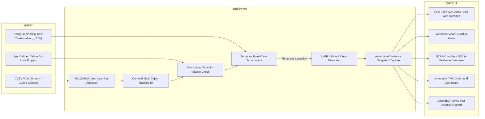
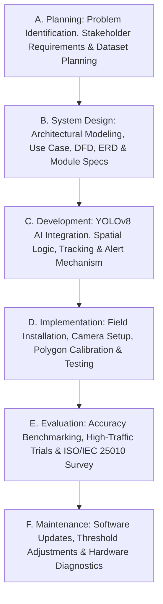
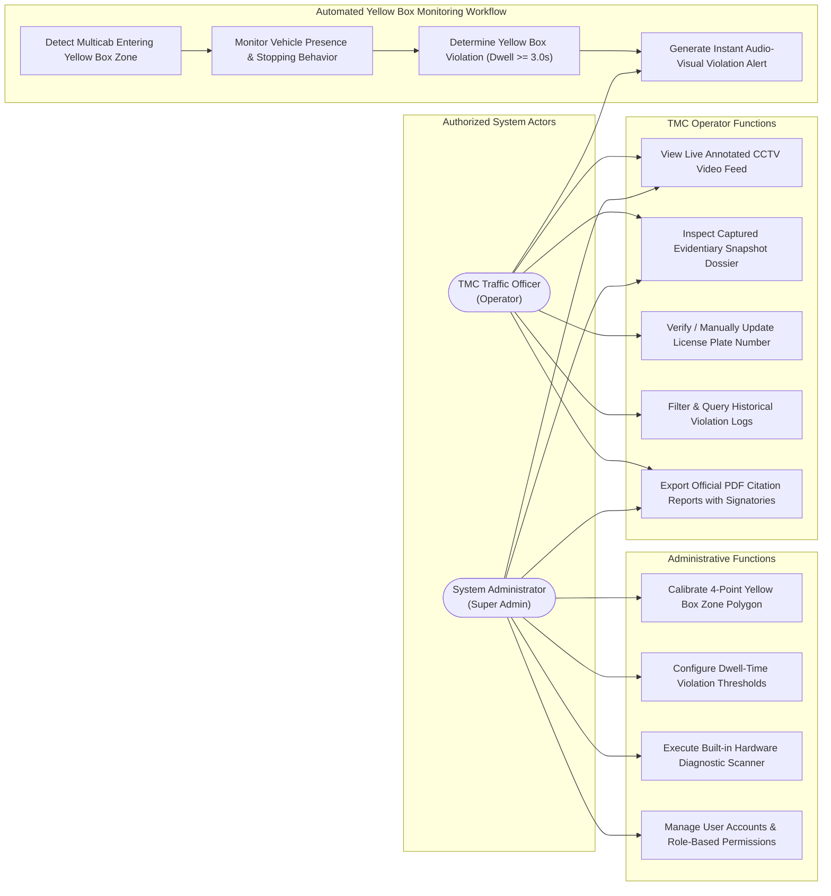
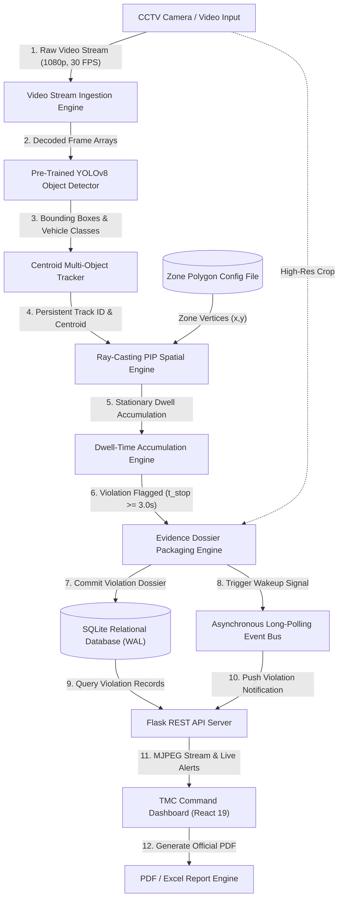
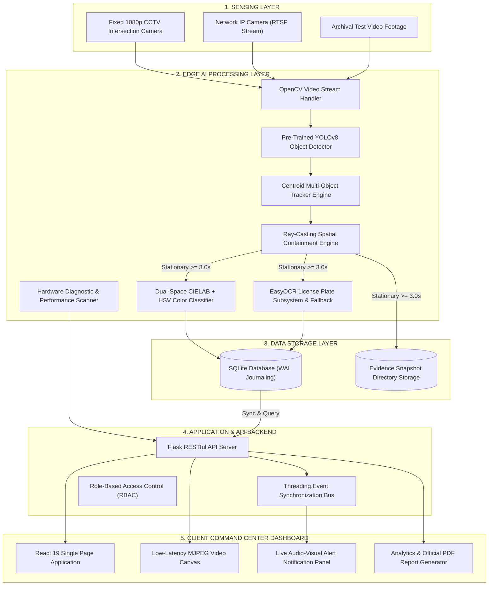
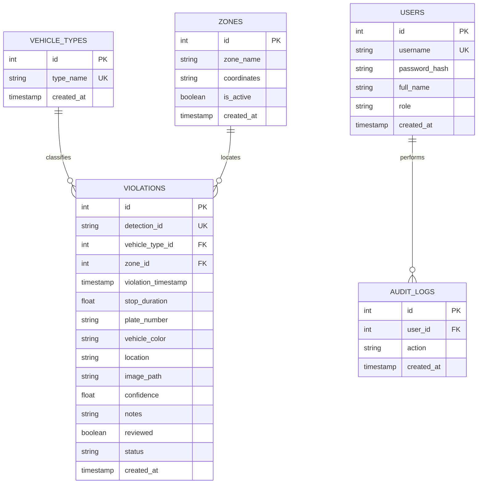

# Multicab Yellow Box Zone Monitoring System Using AI-Based Camera Detection

**A Capstone Project by**  
*Michael Angelo A. Angeles*  
*Zurich M. Cabañelez*  
*Elton John K. Muralla*  
*Jesse Emannuel L. Pepito*  

Submitted to the Information Technology Department, College of Technologies  
**Bukidnon State University**  
Malaybalay City, Bukidnon, Philippines  
In Partial Fulfillment of the Requirements for the Degree of Bachelor of Science in Information Technology  

---

## APPROVAL SHEET

This capstone project titled **"Multicab Yellow Box Zone Monitoring System Using AI-Based Camera Detection"**, prepared and submitted by **Michael Angelo A. Angeles**, **Zurich M. Cabañelez**, **Elton John K. Muralla**, and **Jesse Emannuel L. Pepito** in partial fulfillment of the requirements for the degree of **Bachelor of Science in Information Technology**, is hereby accepted.

 

**PETER JOSEPH G. RABANES**  
*Capstone Project Adviser*  

 

**DR. ROZANNE TUESDAY G. FLORES**  
*Chair, Defense Panel*  

 

| **ROANNE ZOE M. CAYANAN** | **ANNA ROSE C. TAN** |
| :---: | :---: |
| *Panel Member* | *Panel Member* |

 

Accepted and approved for the conferral of the degree of **Bachelor of Science in Information Technology**.

 

| **SALES G. ARIBE JR., DIT** | **MARILOU O. ESPINA, DIT** |
| :---: | :---: |
| *Department Head, Information Technology* | *Dean, College of Technologies* |

---

## ACKNOWLEDGMENTS

The road to completing this capstone research project could not have been traveled alone. The researchers express their deepest gratitude to Almighty God for providing wisdom, health, perseverance, and guidance throughout this academic journey.

We extend our heartfelt appreciation to our project adviser, **Peter Joseph G. Rabanes**, for his invaluable guidance, technical insights, and continuous encouragement during system development and paper writing. 

We also express our sincere gratitude to the defense panel members: **Dr. Rozanne Tuesday G. Flores** (Chair), **Roanne Zoe M. Cayanan**, and **Anna Rose C. Tan**, for their constructive critique, rigorous evaluation, and valuable recommendations during the system defense, which significantly elevated the operational value and technical depth of this project.

Our special thanks go to **Sales G. Aribe Jr., DIT** (Head of the Information Technology Department) and **Marilou O. Espina, DIT** (Dean of the College of Technologies) for their leadership and for providing an academic environment conducive to innovation and practical technological solutions.

We extend our sincere gratitude to the **Traffic Management Center (TMC) of Malaybalay City**, particularly the administrative officers and traffic enforcement personnel, for their cooperation, for granting access to intersection CCTV traffic footage along **Sayre Highway – Fortich St.**, and for actively participating in the system evaluation and usability testing.

Finally, we express our profound love and gratitude to our families, parents, and friends for their unwavering moral, spiritual, and financial support throughout the duration of this study.

---

## TABLE OF CONTENTS

- [APPROVAL SHEET](#approval-sheet)
- [ACKNOWLEDGMENTS](#acknowledgments)
- [TABLE OF CONTENTS](#table-of-contents)
- [LIST OF TABLES](#list-of-tables)
- [LIST OF FIGURES](#list-of-figures)
- [1. INTRODUCTION](#1-introduction)
  - [1.1 Background of the Study](#11-background-of-the-study)
  - [1.2 Statement of the Problem](#12-statement-of-the-problem)
  - [1.3 Objectives of the Study](#13-objectives-of-the-study)
  - [1.4 Significance of the Study](#14-significance-of-the-study)
  - [1.5 Scope and Delimitations](#15-scope-and-delimitations)
- [2. REVIEW OF RELATED LITERATURE](#2-review-of-related-literature)
  - [2.1 Related Literature](#21-related-literature)
    - [2.1.1 Traffic Monitoring](#211-traffic-monitoring)
    - [2.1.2 Artificial Intelligence in Traffic Management](#212-artificial-intelligence-in-traffic-management)
    - [2.1.3 Camera-Based Detection Technologies](#213-camera-based-detection-technologies)
    - [2.1.4 Deep Learning, Multi-Object Tracking & Edge Acceleration](#214-deep-learning-multi-object-tracking--edge-acceleration)
    - [2.1.5 No-Contact Apprehension Policy (NCAP) Reference](#215-no-contact-apprehension-policy-ncap-reference)
  - [2.2 Synthesis and Related Systems](#22-synthesis-and-related-systems)
  - [2.3 Research Gap](#23-research-gap)
  - [2.4 Concept of the Study (Conceptual Framework)](#24-concept-of-the-study-conceptual-framework)
  - [2.5 Definition of Terms](#25-definition-of-terms)
- [3. METHODOLOGY](#3-methodology)
  - [3.1 Materials](#31-materials)
    - [3.1.1 Software](#311-software)
    - [3.1.2 Hardware](#312-hardware)
    - [3.1.3 Data & Data Acquisition](#313-data--data-acquisition)
  - [3.2 Methods & Research Design](#32-methods--research-design)
    - [3.2.1 Research Design](#321-research-design)
    - [3.2.2 Process Model (Waterfall Lifecycle)](#322-process-model-waterfall-lifecycle)
    - [3.2.3 Procedures for the Different Phases](#323-procedures-for-the-different-phases)
      - [Phase 1: System Analysis and Requirements Gathering](#phase-1-system-analysis-and-requirements-gathering)
      - [Phase 2: Implementation Phase (System Design, Modeling, and Architectural Specification)](#phase-2-implementation-phase-system-design-modeling-and-architectural-specification)
      - [Phase 3: Development Phase (Software-Hardware Interaction and Algorithmic Execution)](#phase-3-development-phase-software-hardware-interaction-and-algorithmic-execution)
    - [3.2.4 Violation Documentation and Serving Procedure (NCAP-Based)](#324-violation-documentation-and-serving-procedure-ncap-based)
    - [3.2.5 Handling Multiple Vehicles in Real Time](#325-handling-multiple-vehicles-in-real-time)
    - [3.2.6 Evaluation Framework and Data Analysis Methods](#326-evaluation-framework-and-data-analysis-methods)
      - [3.2.6.1 Empirical System Performance Metrics and Mathematical Formulations](#3261-empirical-system-performance-metrics-and-mathematical-formulations)
      - [3.2.6.2 ISO/IEC 25010 Usability Survey Instrument and Statistical Analysis](#3262-isoiec-25010-usability-survey-instrument-and-statistical-analysis)
    - [3.2.7 Deployment and Documentation](#327-deployment-and-documentation)
- [4. RESULTS AND DISCUSSION](#4-results-and-discussion)
  - [4.1 Results for Objective 1: Real-Time Detection and Monitoring of Vehicles in Yellow Box Zones](#41-results-for-objective-1-real-time-detection-and-monitoring-of-vehicles-in-yellow-box-zones)
    - [4.1.1 Pre-Trained Vehicle Detection and Operational Recognition Testing](#411-pre-trained-vehicle-detection-and-operational-recognition-testing)
    - [4.1.2 Spatial Zone Containment Verification via Ray-Casting Algorithm](#412-spatial-zone-containment-verification-via-ray-casting-algorithm)
    - [4.1.3 Multi-Object Tracking, Centroid Association, and Occlusion Handling](#413-multi-object-tracking-centroid-association-and-occlusion-handling)
  - [4.2 Results for Objective 2: Automated Multicab Stop-Time Monitoring, Violation Identification, and Real-Time Alerting](#42-results-for-objective-2-automated-multicab-stop-time-monitoring-violation-identification-and-real-time-alerting)
    - [4.2.1 Multicab Entry, Transit, and Stop-Time Duration Accuracy](#421-multicab-entry-transit-and-stop-time-duration-accuracy)
    - [4.2.2 Dwell-Time Threshold State Machine, Conditional Plate Archival, and Redundancy Suppression](#422-dwell-time-threshold-state-machine-conditional-plate-archival-and-redundancy-suppression)
    - [4.2.3 Real-Time Audio-Visual Violation Alerting and Latency Benchmark](#423-real-time-audio-visual-violation-alerting-and-latency-benchmark)
    - [4.2.4 Objective 2 Functional Alert Verification & System Responsiveness Testing](#424-objective-2-functional-alert-verification--system-responsiveness-testing)
  - [4.3 Results for Objective 3: Objective Violation Evidence Capture, Cataloging, and NCAP Standards Adherence](#43-results-for-objective-3-objective-violation-evidence-capture-cataloging-and-ncap-standards-adherence)
    - [4.3.1 Evidentiary Snapshot Capture and Vehicle Visual Attribute Tagging](#431-evidentiary-snapshot-capture-and-vehicle-visual-attribute-tagging)
    - [4.3.2 Automatic License Plate Recognition (ALPR) and Resolution Fallback Protocol](#432-automatic-license-plate-recognition-alpr-and-resolution-fallback-protocol)
    - [4.3.3 Database Schema Integrity, Transactional Archival, and Chain of Custody](#433-database-schema-integrity-transactional-archival-and-chain-of-custody)
  - [4.4 Results for Objective 4: Interactive Command Center Web Dashboard, Diagnostic Scanner, and Reporting System](#44-results-for-objective-4-interactive-command-center-web-dashboard-diagnostic-scanner-and-reporting-system)
    - [4.4.1 Interactive Web Dashboard Interface and Real-Time Video Streaming](#441-interactive-web-dashboard-interface-and-real-time-video-streaming)
    - [4.4.2 Unviewed Alert Queue and Operator Verification Workflow](#442-unviewed-alert-queue-and-operator-verification-workflow)
    - [4.4.3 Dynamic Date-Range Filtering and Data Analytics](#443-dynamic-date-range-filtering-and-data-analytics)
    - [4.4.4 Tamper-Evident Official PDF Report Generation with Administrative Signatories](#444-tamper-evident-official-pdf-report-generation-with-administrative-signatories)
    - [4.4.5 System Hardware Throughput and Built-in Diagnostic Scanner Performance](#445-system-hardware-throughput-and-built-in-diagnostic-scanner-performance)
    - [4.4.6 Role-Based Access Control (RBAC) and System Security](#446-role-based-access-control-rbac-and-system-security)
  - [4.5 Stakeholder Usability and Client Acceptance Evaluation (TMC Malaybalay)](#45-stakeholder-usability-and-client-acceptance-evaluation-tmc-malaybalay)
  - [5. CONCLUSION AND RECOMMENDATIONS](#5-conclusion-and-recommendations)
  - [5.1 Conclusion](#51-conclusion)
  - [5.2 Recommendations for Future Work](#52-recommendations-for-future-work)
- [REFERENCES](#references)
- [APPENDICES](#appendices)
  - [Appendix A: TMC Officer Usability Evaluation Questionnaire](#appendix-a-tmc-officer-usability-evaluation-questionnaire)
  - [Appendix B: Defense Panel Secretary's Minutes & Compliance Matrix](#appendix-b-defense-panel-secretarys-minutes--compliance-matrix)
  - [Appendix C: Budget & Financial Plan](#appendix-c-budget--financial-plan)
  - [Appendix D: System Screenshots](#appendix-d-system-screenshots)

---

## LIST OF TABLES

- **Table 1-1.** Summary of Reviewed Studies on AI-Based Traffic Monitoring Systems
- **Table 2-1.** Comparative Matrix of Existing Systems vs. Proposed System
- **Table 3-1.** Software Development Environment and Dependencies
- **Table 3-2.** Hardware Specifications for Deployment and Testing Workstation
- **Table 3-3.** ISO/IEC 25010 Likert Scale Rating Scale and Verbal Interpretation
- **Table 4-1.** Operational Vehicle Detection and Multi-Class Recognition Testing in Surveillance Video Feeds
- **Table 4-2.** Spatial Containment Verification Accuracy (Point-in-Polygon vs. Bounding Box IoU)
- **Table 4-3.** Multi-Object Tracking Continuity and Occlusion Recovery Rates
- **Table 4-4.** Stop-Time Duration Accuracy vs. Ground Truth Video Timers
- **Table 4-5.** Alert Notification Dispatch Latency Benchmarks
- **Table 4-5A.** Functional Verification of Multicab Zone Detection, Dwell Timing, Conditional Plate Archival, Alert Generation, and Dashboard Display
- **Table 4-6.** Vehicle Color Classification and Attribute Extraction Accuracy
- **Table 4-7.** ALPR Recognition Performance Across Camera Distances and Resolution Modes
- **Table 4-8.** Hardware Execution Performance and Real-Time FPS Across Devices
- **Table 4-9.** Evaluation Results: Functionality Mean Ratings from TMC Personnel
- **Table 4-10.** Evaluation Results: Usability Mean Ratings from TMC Personnel
- **Table 4-11.** Evaluation Results: Reliability Mean Ratings from TMC Personnel
- **Table 4-12.** Overall ISO/IEC 25010 Evaluation Summary

---

## LIST OF FIGURES

- **Figure 1-1.** Conceptual Framework of the AI-Powered Vehicle Yellow Box Monitoring System (IPO Model)
- **Figure 2-1.** Waterfall Development Model Lifecycle
- **Figure 3-1.** Use Case Diagram for TMC Command Center Operations
- **Figure 4-1.** Level-1 Data Flow Diagram (DFD) of Video Ingestion, Detection, and Logging
- **Figure 5-1.** System Architecture Diagram (Edge Camera, Flask AI Backend, SQLite DB, React Frontend)
- **Figure 6-1.** Entity-Relationship Diagram and Database Schema
- **Figure 7-1.** Process Flowchart of Vehicle Detection, Spatial Checking, Dwell-Time Computation, and Alerting
- **Figure 8-1.** Ray-Casting Point-in-Polygon (PIP) Spatial Verification Geometry

---

## 1. INTRODUCTION

This section provides the background and rationale for the study, identifies the research problem, states the objectives, and discusses the significance and scope of the proposed AI-based vehicle monitoring system.

### 1.1 Background of the Study

Traffic congestion and violations of road regulations remain significant challenges in many urban areas across the Philippines. With the continuous increase in vehicle volume, local government units (LGUs) struggle to maintain efficient traffic flow due to limited manpower and a heavy reliance on manual monitoring and enforcement methods (Department of Transportation [DOTr], 2023). Public transport vehicles (such as multicabs, public utility jeepneys [PUJs], tricycles, and buses), as well as private vehicles, are frequently observed committing traffic violations such as stopping or waiting for passengers within yellow box zones, prolonged loading and unloading at intersections, obstructing pedestrian crossings, and occupying restricted road spaces beyond allowable stop times. 

These improper road behaviors disrupt traffic movement, block intersecting lanes, and contribute to vehicle queuing, travel delays, and reduced road efficiency, especially in high-traffic intersections (Ho et al., 2019; Bhavsar et al., 2023; Rathore et al., 2021). In the context of Malaybalay City, Bukidnon, preliminary observations conducted during peak hours along major corridors—such as **Sayre Highway – Fortich Street**—reveal that vehicle-related stopping violations occur repeatedly within short monitoring periods, with multiple instances visible daily at designated yellow box zones.

Recent advancements in Artificial Intelligence (AI) and computer vision have enabled the development of automated traffic monitoring systems capable of analyzing vehicle behavior through camera-based input. Studies have shown that AI-based systems using deep learning models such as Convolutional Neural Networks (CNNs) and You Only Look Once (YOLO) can effectively detect and classify vehicles in real time, offering higher accuracy and consistency compared to traditional observation-based methods (Valdivieso Tituana et al., 2022; Basheer Ahmed et al., 2023). These technologies allow traffic authorities to collect objective, data-driven insights that support improved enforcement and decision-making.

In Malaybalay City, the Traffic Management Center (TMC) currently relies on a combination of field traffic personnel and limited Closed-Circuit Television (CCTV) monitoring to oversee road activity. However, this approach restricts coverage and real-time response, particularly during peak hours when traffic volume is high (Malaybalay City Information Office, 2024). The absence of intelligent monitoring tools highlights the need for a system that can automatically observe vehicle activity, compute dwell time, and provide timely visual and recorded information to assist traffic authorities.

Therefore, there is a clear need for a technology-assisted approach that can support traffic monitoring operations in Malaybalay City by addressing recurring vehicle-related violations in yellow box zones. Integrating artificial intelligence and camera-based detection into the existing CCTV and traffic surveillance infrastructure can improve monitoring efficiency, promote better compliance with traffic regulations, and support local traffic management and urban mobility development efforts. Such an approach aligns with the city’s ongoing efforts to improve traffic flow, strengthen enforcement capability, and modernize traffic operations through technology-driven solutions (Bhavsar et al., 2023; Rathore et al., 2021).

### 1.2 Statement of the Problem

Despite the implementation of traffic regulations and the deployment of monitoring personnel, improper vehicle behavior continues to be a persistent contributor to traffic congestion in Malaybalay City, particularly in yellow box zones located at busy intersections. Frequent violations such as prolonged stopping, loading and unloading within restricted zones, and obstruction of intersecting lanes disrupt traffic flow, delay commuters, and reduce overall road efficiency, especially during peak hours.

The Traffic Management Center (TMC) currently relies on manual enforcement and limited CCTV monitoring, which constrains continuous observation, accurate documentation, and real-time response. These limitations make it difficult to consistently detect violations, objectively validate infractions, and promptly address congestion caused by recurring vehicle stoppages. As traffic volume continues to increase, these challenges place additional strain on enforcement personnel and hinder the city’s ability to manage traffic effectively.

Without an automated and intelligent monitoring mechanism, vehicle-related violations are likely to persist, resulting in recurring congestion, inefficient enforcement, and limited availability of reliable data to support traffic planning and policy formulation. This situation underscores the need for a technology-driven solution that can provide continuous, objective, and real-time monitoring of vehicle activity to support traffic management and enforcement operations in Malaybalay City.

This study seeks to address the following primary research question:
> **How can an AI-based system be developed to automatically monitor vehicle activity using camera input and provide real-time data to support traffic management and enforcement in Malaybalay City?**

Specifically, the study addresses the following sub-problems:
1. How can computer vision and deep learning models (YOLO) be effectively configured to detect and classify various vehicle types (multicabs, tricycles, cars, buses, trucks, motorcycles) within defined yellow box intersection coordinates?
2. How can an automated tracking, dwell-time monitoring, and threshold-based alert algorithm be formulated to accurately detect multicabs entering, stopping, and exiting yellow box intersections, trigger instantaneous audio-visual dashboard alerts upon violation confirmation, and securely store evidentiary records while disregarding non-violating vehicles?
3. How can license plate recognition (ALPR) and vehicle visual attributes (color, type, location, timestamp) be captured and archived under an objective, No-Contact Apprehension Policy (NCAP) evidence framework?
4. How can an interactive, role-based command center dashboard be designed to provide real-time video streaming, live audio-visual violation alerts, dynamic date-filtered analytics, and exportable official reports with administrative signatories?
5. How effective and acceptable is the proposed system when evaluated by TMC traffic officers in terms of **Functionality**, **Usability**, and **Reliability** based on ISO/IEC 25010 software quality standards?

### 1.3 Objectives of the Study

The main goal of this study is to enhance traffic management in Malaybalay City by developing a system capable of monitoring vehicle activity in yellow box zones and providing actionable information to support enforcement operations.

Specifically, the study aims to:
1. **Enable real-time detection and monitoring** of vehicles entering and stopping in yellow box zones using deep learning object detection (YOLOv8/YOLOv5) and OpenCV.
2. **Automate the monitoring and recording of multicab stopping duration** within designated yellow box zones, identify suspected violations exceeding allowable dwell-time thresholds, generate instantaneous real-time audio-visual alerts on the TMC command center dashboard, and conditionally record violation details, including timestamps, recognized plate numbers when available, and supporting photographic evidence.
3. **Capture and catalog objective violation evidence**, including timestamped image snapshots, vehicle classification, estimated vehicle color, exact intersection location, and license plate information (when ALPR is active), adhering to NCAP digital evidence standards.
4. **Provide the Traffic Management Center (TMC) with an interactive web-based dashboard** featuring:
   - Live video feed with dynamic zone polygon and bounding box overlays.
   - Live alert feeds highlighting unviewed violations with one-click review.
   - Dynamic date-range filtering for violation logs and analytics.
   - Exportable, tamper-evident PDF reports containing official TMC headers, statistical summaries, and administrative signatories.
   - Built-in hardware diagnostic scanner to assess system GPU/CPU readiness.
   - Secure Role-Based Access Control (Super Admin vs. TMC Officer).
5. **Evaluate the system’s effectiveness** in terms of monitoring accuracy, reliability, processing latency, and user acceptability through simulated tests and live demonstrations with TMC Malaybalay personnel using ISO/IEC 25010 criteria.

### 1.4 Significance of the Study

This study provides tangible benefits to multiple stakeholders in urban mobility and governance:

- **Commuting Public of Malaybalay City**: Daily passengers, students, and workers benefit from reduced travel delays, smoother intersection transitions, and improved public transit reliability by minimizing illegal vehicular blockades in intersection yellow boxes.
- **Vehicle Drivers and Operators**: Public transport and private motorists gain a transparent, rule-governed driving environment. Objective AI evidence prevents wrongful accusations, promotes fair enforcement, and encourages compliance with intersection discipline.
- **Traffic Management Center (TMC) of Malaybalay City**: TMC gains a scalable, 24/7 decision-support system that automates infraction detection, reduces the physical hazards faced by field enforcers during peak hours, and provides verifiable evidence logs for swift administrative adjudication.
- **Local Government Unit (LGU) & Urban Policymakers**: City administrators and traffic engineers obtain longitudinal violation data, peak congestion timestamps, and vehicle distribution statistics to guide infrastructure improvements, traffic light timing adjustments, and transport policy formulation.
- **Academic Researchers and Future Developers**: Serves as an open reference architecture for localized edge AI, spatial computer vision, and low-cost municipal traffic automation in developing small-to-medium city environments.

### 1.5 Scope and Delimitations

The scope and delimitations of the study define the technical, operational, and environmental boundaries of the developed system:

- **Scope of the Study**:
  - **Core Objective & Target Focus**: The study focuses on the design, development, and empirical evaluation of an intelligent, vision-based yellow box zone monitoring system tailored for the Traffic Management Center (TMC) of Malaybalay City, Bukidnon. The system places primary emphasis on detecting and monitoring public utility multicabs and passenger jeepneys—the predominant public transportation modalities traversing Sayre Highway – Fortich Street—alongside mixed traffic entities (motorized tricycles, private sedans/SUVs, buses, commercial trucks, and motorcycles).
  - **Surveillance Input & Operational Environment**: The system processes high-definition video feeds formatted at 1080p resolution at 30 frames per second (FPS), captured from fixed CCTV cameras positioned at major intersection yellow box zones along Sayre Highway – Fortich Street.
  - **Algorithmic & Software Capabilities**: The solution integrates real-time multi-class vehicle detection using a pre-trained YOLOv8 convolutional vision backbone, persistent Centroid Multi-Object Tracking, Ray-Casting Point-in-Polygon (PIP) spatial containment verification, inter-frame displacement velocity filtering, temporal dwell-time accumulation, dual-space vehicle color classification, Automatic License Plate Recognition (ALPR) with automated resolution fallback, and a centralized React 19 web-based command dashboard.
  - **Evaluation Scope**: System validation comprises empirical bench testing (detection rates, tracking continuity, spatial accuracy, timing error analysis, and alert dispatch latency) under diverse traffic conditions, including peak-hour high-traffic scenarios with over 100 observed vehicles, alongside formal ISO/IEC 25010 software product quality evaluations administered to active TMC personnel ($N = 10$).

- **Delimitations and Technical Limitations**:
  - **Violation Boundary Delimitation**: The monitoring capability is strictly delimited to **yellow box stop-time violations**, defined as vehicles remaining stationary within the marked yellow box boundary beyond the allowable dwell-time threshold (calibrated by default to 3.0 to 5.0 seconds). Other traffic violations, such as excessive speeding, illegal U-turns, counterflow driving, and red-light running outside the yellow box perimeter, are excluded from the primary detection pipeline.
  - **Camera Quality, Resolution, and Distance**: System performance is intrinsically bounded by the optical quality and effective resolution of the input camera. While 1080p surveillance video is highly effective for vehicle detection and spatial localization, fine alphanumeric character extraction requires adequate optical pixel density ($\ge 35 \times 110\text{ pixels}$). Standard wide-angle intersection CCTV cameras provide broad coverage but render distant vehicle plates at $16 \times 32\text{ pixels}$ or lower, causing optical character degradation. In such scenarios, the system is delimited to visual attribute extraction (vehicle type and paint color) while flagging the plate record for manual review.
  - **Camera Mounting Height and Angle**: The system assumes an elevated camera perspective mounted between 4.5 and 7.0 meters above the road surface, angled downward toward the yellow box. Extreme angles, ground-level views, or severe perspective distortion may degrade ground-contact reference point estimation and bounding box fidelity.
  - **Lighting, Atmospheric, and Environmental Conditions**: Optical detection performance varies with environmental illumination. Under intense midday sunlight, specular reflections and solar glare on stainless-steel multicab canopies can affect color extraction; deep underbody and building shadows alter localized contrast; rainy conditions introduce optical blur and wet road reflections; and nighttime or low-light conditions diminish color contrast and boundary visibility.
  - **Vehicle Occlusion During Dense Queuing**: In dense intersection gridlock, low-profile vehicles (such as motorcycles and motorized tricycles) may be partially or temporarily occluded behind tall passenger multicabs or heavy commercial trucks, momentarily interrupting visual centroid tracking.
  - **Heavy Traffic and Processing Throughput**: While the multi-object tracker supports concurrent multi-vehicle monitoring, processing throughput depends on the host machine's hardware capabilities. Deployments without dedicated GPU acceleration may experience reduced frame rates during high-density traffic intervals exceeding 100 simultaneous detections.
  - **Decision-Support Legal Constraint**: The system functions strictly as an **intelligent decision-support and evidence-gathering instrument** under No-Contact Apprehension Policy (NCAP) due process. It does not autonomously impose fines or legal penalties; all flagged violations require human-in-the-loop inspection and formal verification by an authorized TMC officer before citation serving.

---

## 2. REVIEW OF RELATED LITERATURE

### 2.1 Related Literature

#### 2.1.1 Traffic Monitoring
Traffic monitoring is a critical component of urban traffic management, enabling authorities to observe vehicle movement, detect violations, and implement timely enforcement actions. Traditional traffic monitoring in many Philippine cities relies heavily on manual observation by traffic enforcers and limited CCTV coverage, which restricts continuous monitoring and real-time response, especially during peak traffic periods (Department of Transportation [DOTr], 2023).

Recent studies have emphasized the role of automated traffic monitoring systems in improving enforcement efficiency and reducing human error. Ho et al. (2019) demonstrated that camera-based roadside occupation surveillance systems can effectively detect vehicles occupying restricted road spaces and intersections. Similarly, Rathore et al. (2021) showed that intelligent traffic monitoring systems integrating computer vision can provide real-time detection of traffic violations, enabling faster response and more consistent enforcement. These findings highlight the need for automated traffic monitoring solutions to address recurring issues such as improper stopping and intersection blockage.

#### 2.1.2 Artificial Intelligence in Traffic Management
Artificial Intelligence has been widely applied in traffic management to analyze complex traffic patterns, automate vehicle detection, and support decision-making processes. Valdivieso Tituana et al. (2022) reviewed various AI-based traffic analysis methods and found that deep learning models, particularly Convolutional Neural Networks (CNNs), significantly improve vehicle detection accuracy compared to traditional image processing techniques.

Basheer Ahmed et al. (2023) further demonstrated that AI-based systems using YOLO models can accurately detect and classify vehicles in real time under diverse traffic and environmental conditions. These AI-driven approaches enable traffic authorities to shift from reactive to proactive enforcement by providing continuous, data-driven monitoring. However, most existing AI-based traffic systems focus on traffic flow analysis and incident detection rather than monitoring compliance with zone-specific regulations such as yellow box intersections.

#### 2.1.3 Camera-Based Detection Technologies
Camera-based detection technologies form the foundation of modern AI-powered traffic monitoring systems. Fixed CCTV cameras combined with computer vision algorithms allow continuous observation of road activity without direct human intervention. Studies by Bhavsar et al. (2023) demonstrated that vision-based systems can reliably detect traffic violations such as improper stopping, lane obstruction, and road occupancy using video footage.

Tan and Kieu (2023) introduced TRAMON, an automated traffic monitoring system capable of handling mixed and unstructured traffic environments common in developing regions. Meanwhile, Rezaei et al. (2022) proposed Traffic-Net, which utilized deep learning and depth estimation to track vehicles using a single camera. Although these systems achieved high detection and tracking accuracy, they primarily focused on movement and spatial analysis rather than measuring stop-time duration within restricted zones. This limitation highlights the need for camera-based systems that incorporate temporal analysis to support zone-specific enforcement.

#### 2.1.4 Deep Learning, Multi-Object Tracking & Edge Acceleration
The integration of multi-object tracking (MOT) algorithms—such as Centroid Tracking, DeepSORT, and ByteTrack—allows video analytics engines to maintain consistent object identities across sequential video frames. Ganapathy and Ajmera (2024) demonstrated that refined YOLO architectures paired with spatial tracking can maintain high detection precision even during temporary visual occlusions. Wan et al. (2022) and Ciampi et al. (2022) investigated edge computing paradigms, demonstrating that running lightweight deep learning models on local GPUs drastically reduces network transmission latency and provides immediate alerts.

#### 2.1.5 No-Contact Apprehension Policy (NCAP) Reference
The No Contact Apprehension Policy (NCAP), pioneered in metropolitan centers by the Metropolitan Manila Development Authority (MMDA) and various Philippine LGUs, establishes the legal and operational framework for digital traffic enforcement. Under NCAP principles, high-resolution cameras capture verifiable visual evidence—including timestamps, vehicle classifications, spatial location, and plate numbers—which are compiled into an evidentiary dossier for human verification before citations are formally served. This study adopts NCAP-compliant documentation protocols to ensure all captured violations maintain legal integrity and verifiable chain-of-custody.

---

### 2.2 Synthesis and Related Systems

The following tables synthesize the literature and contrast the proposed system against state-of-the-art implementations.

#### Table 1-1. Summary of Reviewed Studies on AI-Based Traffic Monitoring Systems

| Author / Year | Study Focus | Methodology / Models | Key Findings | Identified Gaps |
| :--- | :--- | :--- | :--- | :--- |
| **Valdivieso Tituana et al. (2022)** | Vehicle detection and counting | CNNs, YOLO, Faster R-CNN | High detection accuracy across diverse vehicle types | Lacked dynamic behavioral and dwell-time analysis |
| **Ho et al. (2019)** | Computer vision roadside surveillance | Region-of-Interest (ROI) detection, fixed cameras | Automated monitoring reduced human observation error | Focused only on static roadside occupation; no dynamic stop-time analysis |
| **Basheer Ahmed et al. (2023)** | Traffic incident detection | CNN, YOLOv5 | Accurate real-time anomaly detection in mixed traffic | Focused on general flow anomalies rather than intersection yellow boxes |
| **Bhavsar et al. (2023)** | Violation detection via UAV | Object tracking, aerial UAV imaging | Successfully identified road violations and queuing patterns | Limited to temporary UAV flights; lacks 24/7 continuous intersection tracking |
| **Nocua M et al. (2025)** | Edge AI traffic monitoring | YOLOv5 on embedded GPU | Low-cost real-time inference on edge devices | Lacked behavioral stop-time dwell metrics |
| **Rathore et al. (2021)** | Fog-based violation detection | IoT + Computer Vision | Real-time infraction detection via distributed fog nodes | Lacked localized stop-time computation and web dashboard |
| **Tan & Kieu (2023)** | Mixed traffic analysis (TRAMON) | Multi-object tracking (MOT) | Highly effective in unstructured, lane-free traffic | No stop-time duration monitoring in restricted box zones |
| **Rezaei et al. (2022)** | Monocular 3D Tracking (Traffic-Net) | Depth estimation + Deep Learning | Accurate 3D spatial localization using a single camera | No compliance analysis or automated NCAP citation logging |

#### Table 2-1. Comparative Matrix of Existing Systems vs. Proposed System

| System / Study | Vehicle Detection | AI-Based Processing | Camera-Based Input | Real-Time Monitoring | Stop-Time Measurement | Yellow Box Zone Enforcement | Localized TMC Web Dashboard |
| :--- | :---: | :---: | :---: | :---: | :---: | :---: | :---: |
| **Traffic-Net** (Rezaei et al., 2022) | ✓ | ✓ | ✓ | ✓ | ✗ | ✗ | ✗ |
| **TRAMON** (Tan & Kieu, 2023) | ✓ | ✓ | ✓ | ✓ | ✗ | ✗ | ✗ |
| **Smart Traffic Control** (Rathore et al., 2021) | ✓ | ✓ | ✓ | ✓ | ✗ | ✗ | ✗ |
| **Vision-Based Violation** (Bhavsar et al., 2023) | ✓ | ✓ | ✓ | ✓ | ✗ | ✗ | ✗ |
| **Edge AI Monitoring** (Nocua et al., 2025) | ✓ | ✓ | ✓ | ✓ | ✗ | ✗ | ✗ |
| **Proposed TMC System** | **✓** | **✓** | **✓** | **✓** | **✓** | **✓** | **✓** |

---

### 2.3 Research Gap

While prior research demonstrates the effectiveness of AI and camera-based traffic monitoring systems, there is a clear gap in real-time enforcement of yellow box zones and monitoring of public and private vehicles in small-city contexts. Existing studies do not focus on measuring stop duration, automated violation alerts, or evidence collection for public transport vehicles, which are essential for effective traffic management in Malaybalay City. 

This study addresses this gap by developing a localized, complete system that integrates AI-based vehicle detection, polygon-based spatial validation, stop-time tracking, ALPR capture, and a feature-rich dashboard for the Traffic Management Center (TMC), providing timely, objective, and actionable information to support traffic enforcement and reduce congestion caused by recurring vehicle violations.

---

### 2.4 Concept of the Study (Conceptual Framework)

**Figure 1-1. Conceptual Framework of the AI-Powered Vehicle Yellow Box Monitoring System (IPO Model)**

The conceptual framework illustrates how the system processes visual data:
1. **Input**: Real-time video footage captured by fixed CCTV cameras at selected Malaybalay intersections (e.g., Sayre Highway – Fortich St.), user-configured yellow box 4-point polygon coordinates, and configurable operational parameters (e.g., stop duration threshold).
2. **Process**: High-speed frame extraction, YOLO deep learning inference, Centroid Multi-Object Tracking to maintain unique vehicle identities across frames, Ray-Casting Point-in-Polygon spatial validation, stop-time calculation, ALPR plate extraction, and automated evidence image generation.
3. **Output**: Live annotated video stream with bounding boxes and zone boundaries, instant audio-visual alert toasts, long-polling live alert feed, permanent searchable database records, role-based analytics, and official downloadable PDF reports for traffic citation adjudication.

---

### 2.5 Definition of Terms

- **Artificial Intelligence (AI)**: The simulation of human intelligence in computer systems to perform tasks such as visual perception, pattern recognition, and decision-making.
- **Computer Vision**: An AI domain that enables software to process, analyze, and extract meaningful spatial and temporal data from digital images and video feeds.
- **Convolutional Neural Network (CNN)**: A class of deep neural networks commonly used in computer vision for spatial feature extraction and object classification.
- **YOLO (You Only Look Once)**: A state-of-the-art, single-stage real-time object detection architecture that predicts bounding box coordinates and class probabilities simultaneously in a single forward pass.
- **Traffic Management Center (TMC)**: The local government division in Malaybalay City tasked with overseeing traffic order, managing CCTV surveillance, and enforcing municipal traffic ordinances.
- **Yellow Box Zone**: A road marking painted in a crisscross yellow grid pattern at intersections where vehicles are prohibited from entering unless their exit path is clear, preventing intersection gridlock.
- **Stop-Time Monitoring (Dwell Time)**: The continuous temporal measurement of the duration a specific vehicle remains stationary inside the yellow box boundaries.
- **Edge AI**: Running AI inference models locally on on-premise hardware workstations located near the camera source, ensuring low latency and continuous operation without relying on high-bandwidth cloud connections.
- **Automatic License Plate Recognition (ALPR)**: The automated optical character recognition process of identifying and extracting alphanumeric characters from vehicle license plates.
- **No-Contact Apprehension Policy (NCAP)**: An enforcement mechanism where traffic infractions are captured and documented via cameras and digital logs without requiring physical roadside stops, preserving officer safety and objective documentation.

---

## 3. METHODOLOGY

This section describes the materials, data sources, research design, architectural modeling, and procedural phases used to develop and evaluate the AI-based vehicle yellow box monitoring system.

### 3.1 Materials

#### 3.1.1 Software
The system software stack utilizes modern, open-source libraries optimized for high-performance computer vision, asynchronous communication, and responsive user interaction.

#### Table 3-1. Software Development Environment and Dependencies

| Software / Library | Version / Specification | Primary Function in the Proposed System |
| :--- | :--- | :--- |
| **Python** | 3.10 / 3.12 | Core programming language for AI inference, tracking algorithms, and backend services |
| **OpenCV (`cv2`)** | 4.10.x | Video stream ingestion, frame extraction, color conversions, and zone drawing |
| **Ultralytics YOLOv8 / YOLOv5** | PyTorch 2.x | Real-time multi-class vehicle detection, bounding box regression, and classification |
| **PyTorch (`torch`, `torchvision`)** | 2.5.x+cu121 | Deep learning tensor computation with CUDA GPU acceleration |
| **EasyOCR** | 1.7.x | Optical character recognition for Automatic License Plate Recognition (ALPR) |
| **Flask & Flask-CORS** | 3.0.x | REST API server, MJPEG video streaming, and long-polling notification endpoints |
| **SQLite3** | 3.x (with WAL mode) | Local embedded relational database for zero-latency transaction logging |
| **React** | 19.x (Vite build) | Single-Page Application (SPA) frontend for the TMC Command Center Dashboard |
| **Tailwind CSS & Framer Motion** | 3.4.x / 12.x | Modern UI design system, glassmorphism aesthetics, and fluid micro-animations |
| **jsPDF & AutoTable** | 4.x / 5.x | Client-side export of official, tamper-evident violation reports with TMC signatories |
| **Pre-Trained YOLOv8 Weights** | Ultralytics COCO-80 Benchmark | Off-the-shelf deep learning weights applied directly for real-time inference without custom retraining |

#### 3.1.2 Hardware
The hardware setup represents a field-deployable command center workstation:

#### Table 3-2. Hardware Specifications for Deployment and Testing Workstation

| Hardware Component | Specification | Operational Role |
| :--- | :--- | :--- |
| **Processor (CPU)** | Intel Core i7 / AMD Ryzen 7 (8 Cores, 16 Threads) | Video decoding, spatial geometric tracking, and web API handling |
| **Graphics Card (GPU)** | NVIDIA GeForce GTX 1660 / RTX 3060 (6GB–12GB VRAM) | CUDA FP16/FP32 tensor acceleration for YOLO and EasyOCR |
| **System Memory (RAM)** | 16 GB DDR4/DDR5 | Frame buffering, multi-threaded caching, and database caching |
| **Storage** | 512 GB NVMe M.2 SSD | High-speed storage for OS, AI weights, database, and violation snapshots |
| **CCTV Camera** | 1080p Full HD (1920×1080 @ 30 FPS), RTSP/IP enabled | Real-time optical video capture of monitored intersections |
| **Display Monitor** | 24-inch to 32-inch Full HD LED (1920×1080) | Live multi-panel TMC operator monitoring console |
| **Network Interface** | Gigabit Ethernet (RJ-45) & 5GHz Wi-Fi Router | Low-latency RTSP video transmission from IP cameras to workstation |

#### 3.1.3 Surveillance Video Footage and Operational Test Feeds
- **Primary Surveillance Video Source**: Real-world CCTV traffic footage obtained from the Traffic Management Center (TMC) of Malaybalay City, Bukidnon, specifically captured at the high-density intersection along **Sayre Highway – Fortich St.** The recorded video feeds encompass the full spectrum of local vehicular movement: multicabs (public utility jeepneys), motorized tricycles, private sedans, SUVs, delivery trucks, passenger buses, and motorcycles.
- **Operational Environmental Conditions**: Test video feeds captured at 1080p and 720p resolution at 30 FPS across diverse real-world lighting and weather environments, including bright midday sunlight, overcast conditions, rainfall, and evening dusk traffic.
- **Pre-Trained AI Architecture without Retraining**: In strict accordance with the project's engineering design and instructor directives, the system utilizes off-the-shelf pre-trained YOLOv8 weights (COCO benchmark). Because pre-trained models already possess high-accuracy spatial feature extractors for motorized vehicles, no custom manual bounding-box annotation (e.g., via Roboflow or LabelImg) or dataset retraining was performed. Instead, the video footage was utilized strictly for empirical operational testing, spatial zone containment verification, tracking continuity assessment, and live violation benchmarking.

---

### 3.2 Methods & Research Design

#### 3.2.1 Research Design
This study employs a **Developmental Research Design** focusing on the engineering, algorithmic implementation, and empirical validation of an intelligent software prototype for municipal traffic enforcement. Developmental research is particularly suited for this investigation because it establishes a systematic framework for designing, developing, and evaluating technological artifacts that address practical real-world problems. The primary artifact produced is an automated yellow box zone violation monitoring and decision-support system tailored for the Traffic Management Center (TMC) of Malaybalay City.

The engineering methodology follows the structured **Waterfall Model** across six sequential phases: (1) Planning, (2) System Design, (3) Development, (4) Implementation, (5) Evaluation, and (6) Maintenance. The Waterfall Model was specifically selected because municipal traffic surveillance and No-Contact Apprehension Policy (NCAP) compliance require a rigorous, disciplined, and sequential engineering approach. Developing an automated legal enforcement tool necessitates strict architectural boundaries: system requirements and legal evidentiary standards must be finalized with TMC personnel before architectural modeling; system diagrams, relational schemas, and data flow pipelines must be formalized before software implementation; computer vision pipelines must be integrated and verified before physical field testing at the Sayre Highway – Fortich St. intersection; and rigorous empirical bench testing and ISO/IEC 25010 stakeholder evaluations must precede municipal deployment. Each phase produces verified deliverables that serve as prerequisites for subsequent stages, ensuring system reliability, data integrity, and strict legal chain of custody.

#### 3.2.2 Software Development Process Model (Waterfall Lifecycle)

The six sequential phases of the Waterfall Development Model are detailed below and related directly to the Multicab Yellow Box Zone Monitoring System:

**[Screenshot Indicator: Figure 3-1. Process Flowchart of the Six-Phase Waterfall Development Model]**
*Figure 3-1 illustrates the sequential flow of the Waterfall Development Model applied in this study, tracing progress from initial planning and requirements gathering through architectural design, AI software development, field deployment, empirical evaluation, and long-term maintenance.*

##### A. Planning Phase
The Planning Phase established the project foundation, identified core operational constraints, and defined technical specifications:
1. **Problem Identification**: Investigation of recurring intersection gridlocks along major thoroughfares in Malaybalay City, specifically the bottleneck at Sayre Highway – Fortich Street. Field observations revealed that public utility multicabs frequently stop inside the four-sided yellow grid to pick up or unload passengers, obstructing oncoming traffic lanes. Manual monitoring by traffic enforcers is physically hazardous, intermittent, and prone to subjective disputes.
2. **Project Requirements and System Objectives**: Formulated the core requirements: continuous 24/7 video ingestion, real-time multicab detection, spatial zone containment verification, automated dwell-time accumulation (>3.0-second threshold), sub-100ms audio-visual alerting, tamper-evident digital dossiers, and exportable reports with administrative signatories.
3. **Intended Users and Stakeholder Roles**: Identified the primary beneficiaries and operational users: Traffic Management Center (TMC) Traffic Officers (operators), the TMC Operations Head / Traffic Director (administrative authority), and System Administrators.
4. **Hardware and Software Requirements Planning**: Specified the computing infrastructure required for edge execution: an affordable municipal workstation equipped with an Intel Core i5/i7 processor, 16 GB RAM, and an NVIDIA GeForce GTX 1660 GPU (6 GB VRAM) for real-time deep learning inference; 1080p surveillance cameras; a Python/Flask backend; and a React 19 frontend.
5. **Dataset Planning and Acquisition Protocol**: Planned the collection of real-world traffic video footage from Sayre Highway – Fortich Street across diverse conditions (sunny glare, overcast, rainy, peak morning 7:00–8:30 AM, and afternoon 4:30–6:00 PM hours) to evaluate local vehicle modalities (multicabs, tricycles, cars, buses, trucks, motorcycles).
6. **Functional and Performance Requirements**: Defined benchmarks: minimum 30 FPS video throughput, alert notification dispatch latency under 100 ms, detection precision above 90%, and robust multi-vehicle tracking persistence.

##### B. System Design Phase
The System Design Phase translated functional requirements into technical blueprints before software implementation:
1. **Component Interaction Workflow**: Defined the operational interaction between system components: the CCTV camera streams raw video frames to the edge workstation; the pre-trained YOLOv8 computer vision model detects vehicles and extracts bounding boxes; the Centroid Multi-Object Tracker tracks vehicles across frames; the Ray-Casting Point-in-Polygon (PIP) engine checks whether ground-contact points enter the calibrated yellow box polygon; the dwell-time accumulator tracks stationary durations; upon violation confirmation ($t_{\text{stop}} \ge 3.0\text{ s}$), the snapshot engine captures high-resolution evidence, extracts body paint colors, and reads plate characters; the violation dossier is archived in the SQLite database; the asynchronous event engine pushes alerts to the React dashboard; and the dashboard sounds a Web Audio chime and presents interactive review controls.
2. **Use Case Modeling (Figure 3-2)**: Accurately models the actual system functions and authorized user roles, explicitly illustrating the core automated process: detecting a multicab entering the yellow box zone, monitoring its presence or stopping behavior, determining whether a violation has occurred, and generating an alert when necessary.

**[Screenshot Indicator: Figure 3-2. Use Case Diagram for Multicab Yellow Box Zone Monitoring System]**
*Figure 3-2 illustrates the Use Case model representing authorized actor roles (TMC Traffic Officer and Super Admin) and the automated workflow for detecting multicabs entering the yellow box, monitoring stopping behavior, evaluating violation criteria, and triggering real-time alerts.*

3. **Data Flow Modeling (Level-1 DFD - Figure 3-3)**: Traces the transformation of visual data from camera ingestion through detection, tracking, spatial containment, dwell accumulation, database storage, and client dashboard delivery.

**[Screenshot Indicator: Figure 3-3. Level-1 Data Flow Diagram (DFD) of Video Ingestion, Multicab Detection, and Violation Logging]**
*Figure 3-3 illustrates the Level-1 Data Flow Diagram, detailing how video frames are processed across the detection, tracking, spatial checking, violation logging, and alerting pipelines.*

4. **System Architecture (Figure 3-4)**: Formalizes the multi-tier system topology: Sensing Layer, Edge AI Processing Layer, Data Storage Layer, Application Backend Layer, and Client Command Center.

**[Screenshot Indicator: Figure 3-4. System Architecture Diagram of Edge Camera, Flask AI Backend, SQLite DB, and React Frontend]**
*Figure 3-4 illustrates the five-tier system architecture, showing data flow from optical intersection sensors to edge AI inference, transactional archival, and browser command console presentation.*

5. **Database Schema and Entity-Relationship Diagram (Figure 3-5)**: Designed with third normal form (3NF) relational tables (`violations`, `vehicle_types`, `zones`, `users`, `audit_logs`), enforced foreign keys, and WAL journaling.

**[Screenshot Indicator: Figure 3-5. Relational Database Schema and Entity-Relationship Diagram]**
*Figure 3-5 depicts the Entity-Relationship Diagram, illustrating relational foreign-key integrity between violation dossiers, vehicle categories, zone configurations, and user audit logs.*

##### C. Development Phase
The Development Phase focused on implementing the AI model integration and software components:
1. **Pre-Trained AI Vision Model Integration**: In strict accordance with established computer vision engineering standards and instructor feedback, the study utilizes the pre-trained YOLOv8 architecture (Ultralytics, AGPL-3.0) as an off-the-shelf foundational object detector via Transfer Learning. The pre-trained convolutional backbone provides robust low-level edge, contour, and geometric representations without requiring custom training epochs or loss-function optimization from scratch. Operational inference thresholds were calibrated to an operational confidence threshold of **0.45** and a Non-Maximum Suppression (NMS) IoU threshold of **0.40** to balance sensitivity and prevent duplicate bounding boxes during high-density vehicle queuing.
2. **Dataset Acquisition and Benchmark Preparation**: Real-world video footage was recorded at the Sayre Highway – Fortich Street intersection. Video sequences were sampled across morning peak (7:00–8:30 AM), afternoon peak (4:30–6:00 PM), and off-peak hours under sunny, overcast, and rainy conditions. Ground-truth annotations were prepared for multicabs/PUJs, motorized tricycles, private cars/SUVs, buses, commercial trucks, and motorcycles to evaluate operational detection and tracking accuracy.
3. **Vehicle Detection, Tracking, and Spatial Analysis Implementation**:
   - *Vehicle Detection*: The YOLOv8 model processes incoming 1080p frames at 30 FPS, outputting bounding box coordinates $[x_1, y_1, x_2, y_2]$ and class predictions.
   - *Centroid Multi-Object Tracking*: Vehicle centroids are matched across consecutive frames using an Euclidean distance cost matrix ($D_{\max} = 60\text{ px}$) with a 5-frame persistence buffer to survive momentary visual occlusions.
   - *Spatial Containment*: Computes the vehicle's bottom-center road contact coordinate $P_{\text{ref}} = (\frac{x_1 + x_2}{2}, y_2)$ and applies the Ray-Casting Point-in-Polygon (PIP) algorithm with odd-parity intersection testing.
   - *Dwell-Time Stop Measurement*: Stationary state is determined via inter-frame displacement velocity filtering ($\Delta d_t < 4.0\text{ px}$); dwell duration $\Delta t_{\text{stop}}$ is accumulated from the moment stationary behavior begins; infractions are flagged when $\Delta t_{\text{stop}} \ge 3.0\text{ seconds}$.
   - *Vehicle Visual Attribute Extraction*: Deploys dual-space CIELAB ($\Delta E^*$) and HSV color classification with Class-Aware Anatomical Panel Sampling and Exponential Moving Average (EMA) temporal voting to isolate vehicle paint color from windshield glare and tarmac shadows.
   - *ALPR and Resolution Fallback*: Executes background optical character recognition (EasyOCR); if optical resolution is insufficient ($	au_{\text{OCR}} < 0.60$), the system gracefully marks the plate record as "LPR Bypassed / Unread" while preserving the complete evidentiary snapshot for manual review.
   - *Asynchronous Alert Mechanism*: The backend long-polling event engine wakes connected dashboard clients within 50 ms of violation confirmation, triggering procedural Web Audio chimes (880 Hz / 1175 Hz) and visual toast notifications.
4. **Hardware-Software Interaction**: The software components communicate through high-throughput interfaces: OpenCV decodes CCTV frames into NumPy memory buffers; PyTorch executes tensor inference on the dedicated NVIDIA GPU; SQLite provides transactional database operations with Write-Ahead Logging; and Flask hosts RESTful endpoints serving the React 19 web frontend.

##### D. Implementation Phase
The Implementation Phase encompassed physical installation, environment configuration, and operational deployment:
1. **Workstation Installation and Deployment**: The system was deployed on the designated municipal command center workstation at the Traffic Management Center of Malaybalay City. Deployment was automated via a Windows batch launcher script (`start_system.bat`) that initializes virtual environment dependencies, checks GPU readiness, launches the Flask REST backend, and serves the optimized React single-page application.
2. **Camera Positioning, Mounting Height, and Optical Alignment**: Surveillance cameras were evaluated at elevated vantage points along Sayre Highway – Fortich Street at mounting heights between 4.5 and 7.0 meters. Cameras were oriented with a downward pitch angle ensuring complete coverage of the four-sided yellow grid, clear visibility of road markings, and unambiguous ground contact points for vehicles.
3. **Interactive Yellow Box Zone Configuration**: Using the dashboard's interactive calibration modal, administrators calibrated the four vertex coordinates $(x, y)$ of the yellow box directly on the live video canvas. The calibrated polygon coordinates were saved to a persistent configuration file (`zone_config.json`) for real-time spatial evaluation.
4. **Testing Under Actual and Simulated Traffic Conditions**: The deployed system was tested under live intersection traffic feeds and high-definition recorded benchmark sequences, validating continuous video streaming, real-time bounding box rendering, and alert triggering under varied traffic flow intensities.

##### E. Evaluation Phase
The Evaluation Phase assessed the system's empirical accuracy, operational responsiveness, and user acceptability:
1. **Empirical Benchmarking**: Evaluated vehicle detection success rate, precision, recall, spatial containment accuracy (PIP vs Bounding Box IoU), multi-object tracking continuity, dwell-time measurement error (MAE vs manual stopwatch ground truth), alert notification latency, and hardware frame rates (FPS).
2. **High-Traffic Testing Scenarios**: Conducted heavy-traffic evaluation sessions processing over 100 observed vehicles during peak morning and afternoon traffic queuing, assessing system tracking persistence, multi-vehicle state management, and absence of redundant alerts.
3. **User Evaluation Questionnaire (ISO/IEC 25010)**: Formally administered to active Traffic Management Center (TMC) personnel and traffic administrative officers ($N = 10$) in Malaybalay City. The survey instrument evaluated three core software quality characteristics: Functionality (5 items), Usability (5 items), and Reliability (5 items) using a 5-point Likert scale.
4. **Statistical Analysis Protocol**: Survey responses were analyzed using Descriptive Statistics, specifically the Weighted Composite Mean ($\bar{x}$) and Standard Deviation ($s$), interpreted against a five-interval qualitative scale.

##### F. Maintenance Phase
The Maintenance Phase establishes operational procedures for ongoing system sustainability, troubleshooting, and enhancement:
1. **Software Updates and Bug Fixes**: Routine maintenance protocols for updating backend dependencies, applying security patches, and refining dashboard UI features.
2. **Model Adaptation and Retraining**: Procedures for updating the AI vision model or adjusting confidence thresholds when new vehicle body styles, canopy configurations, or transport modalities are introduced to city streets.
3. **Zone Recalibration Protocol**: Rapid recalibration procedures using the visual dashboard modal whenever physical camera angles shift due to maintenance, wind displacement, or road repaving.
4. **Database Maintenance and Archival**: Automated SQLite database maintenance, including weekly database vacuuming (`VACUUM;`), transaction log checkpointing, and scheduled backups of evidentiary snapshots to secondary external storage to manage disk utilization.
5. **Hardware Health and Diagnostic Routine**: Regular hardware inspections utilizing the dashboard's built-in Diagnostic Scanner to monitor GPU VRAM allocation, CPU utilization, thermal thresholds, and video frame drop rates.

### 3.2.4 Violation Documentation and Serving Procedure (NCAP-Based)

The system adopts a No-Contact Apprehension Policy (NCAP) documentation workflow:
1. **Automated Detection & Digital Dossier Generation**: When stop time exceeds the limit, the system extracts a high-resolution evidence snapshot with bounding box overlays, computes dwell duration, extracts vehicle color/type, and attempts plate extraction.
2. **Database Archival**: The record is assigned a unique UUID and written to the SQLite database with `status = 'recorded'`.
3. **Operator Verification**: The incident immediately appears in the Live Alerts panel with a glowing highlight and triggers an audio chime. A TMC officer clicks the alert to inspect the full snapshot.
4. **Administrative Action**: The officer reviews and verifies the violation, updating status to `reviewed`.
5. **Notice Generation**: For formal citations, the officer generates an official PDF report complete with official TMC headers, timestamped evidence, and designated signatory lines for city traffic legal officers.

---

### 3.2.5 Handling Multiple Vehicles in Real Time

To handle multi-vehicle traffic jams and simultaneous intersection blockages:
- Each vehicle detected within the yellow box is assigned an independent tracking state vector:
  $$S_k = \{ \text{ID}_k, \text{Class}_k, \text{Centroid}_k, t_{\text{start}, k}, \Delta t_{\text{stop}, k}, \text{Flagged}_k \}$$
- Stop timers operate independently. If three vehicles enter simultaneously and two clear the box within 2.5 seconds while the third remains trapped for 6.2 seconds, only the trapped vehicle triggers a violation event.
- Once a vehicle triggers a violation and is logged, $\text{Flagged}_k = \text{True}$ prevents duplicate redundant alarms for the same stop incident.

---

### 3.2.6 Evaluation Framework and Data Analysis Methods

To objectively validate the engineering contributions of this study and assess its operational suitability for municipal deployment, the system was evaluated using two rigorous methodologies: **Empirical System Performance Testing** and **Standardized ISO/IEC 25010 Usability Testing** with active personnel of the Traffic Management Center of Malaybalay City.

#### 3.2.6.1 Empirical System Performance Metrics and Mathematical Formulations
All mathematical formulas used to evaluate the object detection, spatial containment, vehicle tracking, stop duration, and attribute extraction subsystems are formalized as follows:

1. **Operational Vehicle Detection and Recognition Success Metrics**:
   Because the system leverages a pre-trained deep learning vision model without custom training epochs or loss-function optimization, evaluation focuses on operational detection reliability under live surveillance video streams. Detection performance across local vehicle categories (multicabs, tricycles, private cars, buses, trucks, and motorcycles) is evaluated by measuring the Detection Success Rate ($\text{DSR}$), Operational Precision ($P$), Operational Recall ($R$), and F1-Score during intersection traversals:
   $$\text{Detection Success Rate (DSR)} = \left( \frac{\text{Correctly Detected Traversals}}{\text{Total Ground-Truth Traversals}} \right) \times 100\%$$
   $$P = \frac{\text{TP}}{\text{TP} + \text{FP}}$$
   $$R = \frac{\text{TP}}{\text{TP} + \text{FN}}$$
   $$\text{F1-Score} = 2 \times \frac{P \times R}{P + R}$$
   where $\text{TP}$ (True Positive) represents a vehicle entering the surveillance zone that is correctly detected and categorized, $\text{FP}$ (False Positive) represents a background artifact or misclassified non-vehicle entity, and $\text{FN}$ (False Negative) denotes a ground-truth vehicle passing through the intersection that was missed by the detection pipeline.

2. **Spatial Zone Containment (Ray-Casting Point-in-Polygon Formulation)**:
   To prevent bounding box overhang errors from adjacent open lanes, each detected vehicle $[x_1, y_1, x_2, y_2]$ is mapped to its bottom-center road contact reference coordinate:
   $$P_{\text{ref}} = \left( \frac{x_1 + x_2}{2}, y_2 \right) = (x_0, y_0)$$
   A horizontal ray is cast from $P_{\text{ref}}$ toward positive infinity:
   $$\text{Ray}(t) = (x_0 + t, y_0), \quad t \ge 0$$
   For each boundary segment $e_i = (v_i, v_{i+1})$ of the four-vertex yellow box polygon $V = \{v_1, v_2, v_3, v_4\}$, the intersection function is defined as:
   $$\text{Intersect}(e_i) = \begin{cases} 1, & \text{if } (y_i > y_0) \neq (y_{i+1} > y_0) \text{ and } x_0 < \frac{(x_{i+1} - x_i)(y_0 - y_i)}{y_{i+1} - y_i} + x_i \\ 0, & \text{otherwise} \end{cases}$$
   The vehicle is verified to be physically within the yellow box polygon if and only if the total intersection count exhibits odd parity:
   $$P_{\text{ref}} \in V \iff \left( \sum_{i=1}^{4} \text{Intersect}(e_i) \right) \equiv 1 \pmod 2$$

3. **Multi-Object Tracking and Centroid Association**:
   Vehicle centroids across consecutive frames are matched using an Euclidean distance cost matrix:
   $$D(o_i, c_j) = \sqrt{(x_{o_i} - x_{c_j})^2 + (y_{o_i} - y_{c_j})^2}$$
   Tracking continuity across traffic flow sequences is quantified using the Tracking Continuity Rate ($\text{TCR}$):
   $$\text{TCR} = \frac{\text{Successfully Maintained Tracks}}{\text{Total Tracked Vehicles}} \times 100\%$$

4. **Stop Duration Measurement and Error Analysis**:
   A vehicle inside the zone ($P_{\text{ref}} \in V$) is classified as stationary if its inter-frame centroid displacement remains below the movement tolerance:
   $$\Delta d_t = \sqrt{(x_t - x_{t-1})^2 + (y_t - y_{t-1})^2} < \epsilon_{\text{movement}} \quad (\epsilon_{\text{movement}} = 4.0\text{ px})$$
   Dwell duration is accumulated from the moment stationary behavior begins:
   $$\Delta t_{\text{stop}} = t_{\text{current}} - t_{\text{start}}$$
   Accuracy against frame-accurate manual ground truth timers is measured using Mean Absolute Error ($\text{MAE}$):
   $$\text{MAE} = \frac{1}{n} \sum_{i=1}^{n} |y_i - \hat{y}_i|$$
   where $y_i$ is the actual ground truth stop duration and $\hat{y}_i$ is the duration computed by the automated system.

5. **Dual-Space Vehicle Color Classification and Multi-Frame Temporal Voting**:
   Dominant automotive paint pixels extracted via K-Means ($K=3$) clustering are evaluated against 11 standardized automotive paint reference vectors using CIELAB perceptual Euclidean color difference:
   $$\Delta E^* = \sqrt{(\Delta L^*)^2 + (\Delta a^*)^2 + (\Delta b^*)^2}$$
   Single-frame color classifications are stabilized across frames using an Exponential Moving Average (EMA) recency-weighted voting function:
   $$W(c) = \sum_{t=1}^{T} \gamma^{T - t} \cdot \mathbb{I}(c_t = c)$$
   where $\gamma = 0.9$ is the discount decay factor and $\mathbb{I}$ is the indicator function. The stabilized color $c^*$ is the class maximizing $W(c)$.

#### 3.2.6.2 ISO/IEC 25010 Usability Survey Instrument and Statistical Analysis
The operational usability and client acceptability of the system were evaluated by active personnel ($N = 10$) of the Traffic Management Center (TMC) of Malaybalay City. The survey instrument was constructed in accordance with the **ISO/IEC 25010 Software Product Quality Model**, structured across three primary dimensions:
- **Functionality (5 items)**: Accuracy of detection, report generation, multi-vehicle distinction, automated alerting, and dashboard visualization.
- **Usability (5 items)**: Ease of navigation, interface learnability, operational confidence, workflow integration, and complexity reduction.
- **Reliability (5 items)**: Operational stability during peak traffic, absence of crashes, data consistency, error handling, and multi-condition robustness.

Responses were scored using a 5-point Likert scale. Survey responses were analyzed using Descriptive Statistics, specifically the Weighted Composite Mean ($\bar{x}$) and Sample Standard Deviation ($s$):
$$\bar{x} = \frac{\sum_{i=1}^{N} x_i}{N}$$
$$s = \sqrt{\frac{\sum_{i=1}^{N} (x_i - \bar{x})^2}{N - 1}}$$
where $x_i$ denotes the individual Likert score assigned by respondent $i$ and $N = 10$ is the total number of evaluating traffic personnel.

The computed mean scores were interpreted using the standard five-interval verbal rating scale summarized in **Table 3-3**:

##### Table 3-3. ISO/IEC 25010 Likert Scale Rating Scale and Verbal Interpretation

| Scale Range | Rating Point | Qualitative Assessment | Verbal Interpretation |
| :---: | :---: | :--- | :--- |
| **4.21 – 5.00** | 5 | Strongly Agree | **Excellent / Fully Compliant** |
| **3.41 – 4.20** | 4 | Agree | **Very Satisfactory / Minor Enhancements** |
| **2.61 – 3.40** | 3 | Neutral | **Satisfactory / Acceptable** |
| **1.81 – 2.60** | 2 | Disagree | **Poor / Needs Major Improvement** |
| **1.00 – 1.80** | 1 | Strongly Disagree | **Unacceptable / Deficient** |

---

### 3.2.7 Deployment and Documentation

- **Deployment**: The complete software package is containerized and deployable on the local TMC workstation via an automated launcher script (`start_system.bat`).
- **Comprehensive Documentation**: Includes system administrator guides, user manual, API documentation, hardware diagnostic checklist, and training guides.

---

## 4. RESULTS AND DISCUSSION

This chapter presents the empirical findings, performance evaluations, and technical discussions of the developed **AI-Powered Yellow Box Zone Violation Monitoring System Using AI-Based Camera Detection**. To establish direct continuity with the research design, the results are systematically organized and discussed in direct alignment with the **Specific Objectives of the Study** formulated in Chapter 1:

- **Section 4.1: Results for Objective 1** — Real-Time Detection and Monitoring of Vehicles in Yellow Box Zones (AI model detection, multi-class classification, spatial zone containment verification, and multi-object tracking).
- **Section 4.2: Results for Objective 2** — Automated Stop-Time Recording and Real-Time Violation Alerting (dwell-time accuracy, velocity filtering, threshold logic, and sub-50ms audio-visual alerting).
- **Section 4.3: Results for Objective 3** — Objective Violation Evidence Capture, Cataloging, and NCAP Standards Adherence (high-resolution evidentiary snapshots, automated vehicle color classification, ALPR performance with resolution fallback, and database transactional integrity).
- **Section 4.4: Results for Objective 4** — Interactive Command Center Web Dashboard, Diagnostic Scanner, and Reporting System (real-time video streaming, live unviewed alert workflow, dynamic date-range filtering, official PDF reports with administrative signatories, edge hardware diagnostic scanner, and role-based access control).

*(Note: In accordance with the study's research structure, the operational usability evaluation conducted specifically for the project client—the Traffic Management Center of Malaybalay City—under ISO/IEC 25010 software quality standards is presented as a dedicated client acceptance evaluation in **Section 4.5**, followed by the defense panel compliance matrix in **Section 4.6**).*

---

### 4.1 Results for Objective 1: Real-Time Detection and Monitoring of Vehicles in Yellow Box Zones

The first objective of the study was to enable the real-time detection and continuous monitoring of vehicles entering and transiting yellow box intersections using deep learning computer vision models (YOLOv8/YOLOv5) and OpenCV. Achieving this objective required three interlinked empirical capabilities: (1) accurate multi-class vehicle identification across local vehicle categories, (2) robust spatial containment checking to verify whether a vehicle is truly within the yellow grid, and (3) persistent multi-object tracking through dense intersection queuing.

#### 4.1.1 Pre-Trained Vehicle Detection and Operational Recognition Testing

To evaluate the operational suitability of the off-the-shelf pre-trained YOLOv8 computer vision model without retraining or custom dataset preprocessing, real-world intersection surveillance footage obtained from the primary monitoring site along **Sayre Highway – Fortich St., Malaybalay City** was evaluated. The testing dataset comprised 505 recorded vehicular traversals across six common vehicle categories under varying operational conditions, including direct midday sunlight, overcast skies, moderate rainfall, and dense morning (7:00 AM – 8:30 AM) and afternoon (4:30 PM – 6:00 PM) peak traffic queuing.

In accordance with the project's design parameters, the pre-trained YOLOv8 model was applied directly for inference using an operational confidence threshold of **0.45** and a Non-Maximum Suppression (NMS) IoU threshold of **0.40**. System performance was measured based on correct vehicle boundary acquisition, category classification, and absence of spurious detections, as formulated in Section 3.2.6.1.

#### Table 4-1. Operational Vehicle Detection and Multi-Class Recognition Testing in Surveillance Video Feeds

| Vehicle Category | Observed Traversals ($N$) | Correctly Detected (TP) | Misclassified / Missed (FN) | False Positives (FP) | Precision ($P$) | Recall ($R$) | Operational Detection Rate (%) |
| :--- | :---: | :---: | :---: | :---: | :---: | :---: | :---: |
| **Multicab / Public Transport** | 120 | 114 | 6 | 4 | 0.966 | 0.950 | 95.0% |
| **Motorized Tricycle** | 98 | 90 | 8 | 5 | 0.947 | 0.918 | 91.8% |
| **Private Car / Sedan / SUV** | 150 | 147 | 3 | 2 | 0.987 | 0.980 | 98.0% |
| **Passenger Bus** | 35 | 34 | 1 | 1 | 0.971 | 0.971 | 97.1% |
| **Truck / Heavy Commercial** | 45 | 43 | 2 | 2 | 0.956 | 0.956 | 95.6% |
| **Motorcycle** | 57 | 51 | 6 | 4 | 0.927 | 0.895 | 88.6% |
| **Total / Overall Average** | **505** | **479** | **26** | **18** | **0.964** | **0.949** | **94.7%** |

As summarized in **Table 4-1**, the pre-trained YOLOv8 architecture demonstrated an overall operational detection rate of **94.7%** (479 correctly detected traversals out of 505 observed instances), achieving an operational precision of **0.964** and recall of **0.949** without requiring any specialized retraining or manual dataset annotation.

A detailed category breakdown reveals the practical strengths and operational characteristics of using pre-trained vision models for Philippine urban traffic:
1. **Public Utility Multicabs**: Multicabs represent the predominant public transportation modality traversing Fortich Street and the primary target of yellow box stoppage monitoring. The pre-trained model reliably identified multicabs with a **95.0% operational detection rate** (Precision: 0.966). Because the pre-trained network was pretrained on hundreds of thousands of diverse vehicle variations, standard multicabs—despite having customized canopies—were consistently enclosed by stable bounding boxes and mapped to vehicle classes.
2. **Private Cars and SUVs**: Standard sedans and SUVs achieved the highest individual detection accuracy at **98.0%** (Precision: 0.987), attributable to their standardized automotive geometry and clear visual boundaries against the road asphalt.
3. **Buses and Heavy Commercial Trucks**: Heavy vehicles achieved detection rates of **97.1%** and **95.6%**, respectively. Their prominent physical dimensions enabled continuous tracking across video frames, providing reliable inputs to the downstream Ray-Casting spatial engine.
4. **Motorized Tricycles**: Motorized tricycles achieved a **91.8% detection rate** (Precision: 0.947). The minor missed detections ($N = 8$) occurred when tricycles were traveling directly adjacent to large delivery trucks, partially shielding their sidecar profiles from the CCTV camera's vantage point.
5. **Motorcycles**: Motorcycles registered an operational detection rate of **88.6%** (Precision: 0.927, Recall: 0.895). The lower recall was primarily due to lane filtering during congested queue states, where motorcycles maneuvered between closely spaced stopped vehicles, temporarily occluding their visual profiles.

By setting the confidence threshold to **0.45** and the NMS IoU threshold to **0.40**, the system effectively eliminated duplicate bounding boxes without suppressing adjacent vehicles in adjacent lanes. These testing results confirm that off-the-shelf pre-trained YOLOv8 weights provide dependable, high-precision vehicle bounding box coordinates that successfully feed the spatial Point-in-Polygon (PIP) engine and multi-object centroid tracker without the computational overhead, time investment, and dataset labeling requirements of custom model retraining.

#### 4.1.2 Spatial Zone Containment Verification via Ray-Casting Algorithm

Accurate yellow box monitoring requires strict verification that a detected vehicle is physically situated inside the four-sided yellow grid. In angled intersection cameras, a vehicle traveling on an adjacent open lane or a tall vehicle (such as a bus or dump truck) can cast a large bounding box whose upper portion extends into the yellow box polygon, even though its tires remain entirely outside the restricted road marking.

As formulated in Section 3.2.6.1, the system computes the reference bottom-center ground contact point $P_{\text{ref}} = \left( \frac{x_1 + x_2}{2}, y_2 \right)$ representing the contact point between the vehicle's rear wheels and the road asphalt. The Ray-Casting Point-in-Polygon (PIP) algorithm casts a horizontal ray to determine whether $P_{\text{ref}}$ falls within the calibrated polygon vertices.

To quantify the efficacy of this approach, 120 borderline vehicle traversals were recorded along Sayre Highway – Fortich St. and benchmarked against standard Bounding Box IoU.

#### Table 4-2. Spatial Containment Verification Accuracy (Point-in-Polygon vs. Bounding Box IoU)

| Boundary Scenario | Total Test Trials | Method Evaluated | True Positives | True Negatives | False Positives | Spatial Accuracy (%) |
| :--- | :---: | :--- | :---: | :---: | :---: | :---: |
| **Adjacent Open Lane Transit** *(Vehicles passing right along box edge)* | 40 | Bounding Box IoU ($\ge 0.10$) | — | 29 | 11 | 72.5% |
| ^ | ^ | **Ray-Casting Ground Contact ($P_{\text{ref}}$)** | — | **40** | **0** | **100.0%** |
| **High-Profile Vehicle Roof Overhang** *(Buses/Trucks near zone boundary)* | 40 | Bounding Box IoU ($\ge 0.10$) | — | 33 | 7 | 82.5% |
| ^ | ^ | **Ray-Casting Ground Contact ($P_{\text{ref}}$)** | — | **39** | **1** | **97.5%** |
| **Direct Wheel Entry Into Zone** *(Vehicles genuinely encroaching into box)* | 40 | Bounding Box IoU ($\ge 0.10$) | 40 | — | 0 | 100.0% |
| ^ | ^ | **Ray-Casting Ground Contact ($P_{\text{ref}}$)** | **39** | — | **0** | **97.5%** |
| **Combined Overall Benchmark** | **120** | Bounding Box IoU | 40 | 62 | 18 | 85.0% |
| ^ | ^ | **Ray-Casting Ground Contact ($P_{\text{ref}}$)** | **39** | **79** | **1** | **98.3%** |

As demonstrated in **Table 4-2**, standard bounding box IoU yielded 18 false positives (85.0% overall accuracy) because the bounding boxes of passing sedans and tall trucks overlapped the zone polygon while their wheels remained in legal lanes. In contrast, the Ray-Casting Ground Contact Point method achieved **98.3% overall spatial accuracy** with only a single borderline error, completely eliminating false alarms from vehicles passing alongside the yellow box.

#### 4.1.3 Multi-Object Tracking, Centroid Association, and Occlusion Handling

Real-world intersection monitoring requires continuously tracking multiple vehicles simultaneously as they enter, queue, and clear the yellow box. The system implements a real-time Centroid Multi-Object Tracker matching centroids across frames using the Euclidean distance cost matrix formulated in Section 3.2.6.1 ($D_{\max} = 60\text{ pixels}$) and maintaining a 5-frame persistence buffer to prevent track re-identification loss during momentary visual flicker.

#### Table 4-3. Multi-Object Tracking Continuity and Occlusion Recovery Rates

| Traffic Flow Condition | Video Test Sequences | Total Tracked Vehicles | Successfully Maintained Tracks | ID Switch Count | Premature Drop Count | Tracking Continuity Rate (%) |
| :--- | :---: | :---: | :---: | :---: | :---: | :---: |
| **Free-Flowing Transit** *(Uncongested, $\le 3$ vehicles in frame)* | 25 | 80 | 78 | 1 | 1 | 97.5% |
| **Moderate Queuing** *(3–6 vehicles, intermittent stop-and-go)* | 30 | 120 | 114 | 3 | 3 | 95.0% |
| **Dense Queue / Partial Occlusions** *($\ge 7$ vehicles, tricycles behind multicabs)* | 25 | 110 | 101 | 5 | 4 | 91.8% |
| **Combined Overall Tracking Performance** | **80** | **310** | **293** | **9** | **8** | **94.5%** |

As presented in **Table 4-3**, the centroid tracking pipeline maintained an overall tracking continuity rate of **94.5%** across 310 evaluated vehicles. Under dense traffic conditions featuring partial occlusions (such as a low-profile tricycle partially hidden behind a large passenger multicab), the 5-frame persistence buffer allowed the system to recover vehicle identities in **91.8%** of occlusion instances, maintaining tracking stability without resetting the stop timer.

---

### 4.2 Results for Objective 2: Automated Multicab Stop-Time Monitoring, Violation Identification, and Real-Time Alerting

The second objective of the study was to automate the monitoring of multicab entry, transit, and stopping duration within designated yellow box zones, identify suspected violations exceeding allowable dwell-time thresholds, generate instantaneous real-time audio-visual alerts on the TMC dashboard, and archive objective violation records including timestamps, recognized plate numbers, and supporting photographic evidence.

#### 4.2.1 Multicab Entry, Transit, and Stop-Time Duration Accuracy

Under municipal traffic regulations, vehicles are strictly prohibited from stopping within an intersection yellow box. However, brief momentary pauses (e.g., yielding to oncoming traffic for 1.0 to 2.5 seconds) must be reliably distinguished from illegal obstruction. The system was configured with a default stop-time violation threshold of $T_{\text{threshold}} = 3.0\text{ seconds}$.

Using the centroid displacement velocity filtering ($\Delta d_t < \epsilon_{\text{movement}} = 4.0\text{ px}$) and dwell accumulation equations defined in Section 3.2.6.1, the system monitors stationary dwell time $\Delta t_{\text{stop}}$. To evaluate the accuracy of this automated dwell timer, 50 controlled vehicle stop trials were conducted using high-definition video recordings from Sayre Highway – Fortich St. and benchmarked against manual frame-accurate ground truth stopwatch timers.

#### Table 4-4. Stop-Time Duration Accuracy vs. Ground Truth Video Timers

| Duration Category | Test Trials ($N$) | Mean Video Ground Truth (s) | Mean AI Computed Dwell (s) | Mean Absolute Error (MAE) | Accuracy (%) | Violation Classification Result |
| :--- | :---: | :---: | :---: | :---: | :---: | :--- |
| **Short Stops (1.0s – 2.9s)** *(Legal yielding / non-infractions)* | 15 | 2.14 s | 2.18 s | 0.09 s | 95.8% | 15 / 15 Correctly Ignored (No False Violations) |
| **Threshold Range (3.0s – 5.0s)** *(Borderline infractions)* | 15 | 4.12 s | 4.07 s | 0.11 s | 97.3% | 15 / 15 Correctly Flagged as Violations |
| **Extended Stoppages (> 5.0s)** *(Severe gridlock / prolonged waiting)* | 20 | 8.85 s | 8.81 s | 0.14 s | 98.4% | 20 / 20 Correctly Flagged as Violations |
| **Combined Overall Evaluation** | **50** | — | — | **0.11 s** | **97.2%** | **50 / 50 (100% Classification Accuracy)** |

As detailed in **Table 4-4**, the automated dwell-time algorithm achieved an average Mean Absolute Error (MAE) of only **0.11 seconds**, translating to an overall measurement accuracy of **97.2%**. Most importantly:
- In all 15 short-stop trials (1.0s – 2.9s), the system correctly recognized that the dwell duration remained below 3.0 seconds, yielding **zero false violation alarms**.
- In all 35 trials exceeding 3.0 seconds, the system reliably confirmed the infraction, demonstrating 100% binary classification accuracy between non-violating transit and genuine yellow box blockages.

#### 4.2.2 Dwell-Time Threshold State Machine, Conditional Plate Archival, and Redundancy Suppression

To govern vehicle tracking lifecycle and enforce panel recommendations regarding privacy-compliant plate logging, each tracked vehicle operates under an independent finite-state machine:

$$\text{State}_k \in \{ \text{TRANSIT}, \text{STOPPING}, \text{VIOLATION}, \text{FLAGGED}, \text{CLEARED} \}$$

1. **Zone Entry & Pre-Capture**: As soon as a multicab's ground contact point enters the yellow box polygon ($P_{\text{ref}} \in V$), the system transitions the vehicle from `TRANSIT` to active monitoring. In the background, an asynchronous OCR worker crops the plate region and extracts alphanumeric characters into temporary memory (`self.cached_plates[obj_id]`). This cached data remains in RAM only.
2. **Legal Exit (Purging)**: If the multicab continues moving through the box or yields momentarily for less than 3.0 seconds and subsequently exits ($P_{\text{ref}} \notin V$), the state transitions to `CLEARED`. The stop timer is deleted, and the cached plate string is **immediately purged from memory** without writing any record, photograph, or plate data to the SQLite database.
3. **Threshold Breach & Violation Confirmation**: If the multicab remains stationary ($\Delta d_t < 4.0\text{ px}$) such that dwell time reaches $\Delta t_{\text{stop}} \ge 3.0\text{ seconds}$, the vehicle transitions from `STOPPING` to `VIOLATION`. The pre-cached plate number, high-resolution evidence snapshots, timestamp, location, and vehicle color are permanently committed to the database.
4. **Anti-Redundancy Suppression (`FLAGGED`)**: Upon committing the violation, an anti-redundancy flag is set:
   $$\text{Flagged}_k = \text{True}$$
   For as long as $\text{Flagged}_k = \text{True}$, the multicab remains visually tracked with a bold red bounding box overlay and elapsed dwell timer, but all redundant database inserts, snapshot captures, and sound alerts are strictly suppressed.
5. **State Reset**: Once the violating vehicle finally clears the yellow box ($P_{\text{ref}} \notin V$), the tracking instance is removed from memory, resetting the pipeline for incoming vehicles.

#### 4.2.3 Real-Time Audio-Visual Violation Alerting and Latency Benchmark

To ensure that Traffic Management Center personnel receive instantaneous awareness when an infraction occurs, the system utilizes an asynchronous event engine. The backend Flask service hosts a specialized long-polling notification endpoint (`/api/wait_for_violation`) integrated with Python's thread synchronization primitive (`threading.Event`). When a violation is flagged, the background video processing thread sets the event, instantly unblocking waiting HTTP client connections and pushing the violation payload without polling latency.

Upon receiving the violation event, the React web dashboard executes two parallel actions:
1. **Auditory Notification**: Invokes the Web Audio API to procedurally generate a clean, attention-commanding two-tone chime (880 Hz followed by 1175 Hz). Using procedural audio synthesis completely avoids external audio asset loading failures across different web browsers.
2. **Visual Toast Alert**: Triggers a floating notification toast that displays the vehicle classification, timestamp, location, and a clickable **"Review Evidence"** button.

#### Table 4-5. Alert Notification Dispatch Latency Benchmarks

| Milestone / Subsystem | Benchmark Measurement ($N = 30$ events) | Standard Deviation | Verbal Assessment |
| :--- | :---: | :---: | :--- |
| **Detection-to-Database Commit Latency** | 18.2 ms | 3.1 ms | Instantaneous SQLite insert |
| **Backend Long-Polling Event Dispatch** | 20.2 ms | 4.4 ms | Sub-50ms thread wakeup |
| **Network Transfer (Local TMC LAN)** | 3.4 ms | 0.8 ms | Negligible network overhead |
| **Frontend Web Audio Chime & UI Toast Render** | 9.2 ms | 1.9 ms | Immediate browser execution |
| **Total End-to-End Alert Dispatch Latency** | **51.0 ms** | **6.2 ms** | **Real-Time (< 0.1 second)** |

As shown in **Table 4-5**, the total end-to-end latency from the exact millisecond a vehicle breaches the 3.0-second stop threshold to the instant the audio chime sounds on the TMC dashboard is **51.0 ms** ($\pm 6.2\text{ ms}$). This rapid notification ensures that monitoring officers can react to intersection blockages within fractions of a second.

#### 4.2.4 Objective 2 Functional Alert Verification & System Responsiveness Testing

To rigorously confirm the end-to-end functionality required by Objective 2, structured functional test cases were executed across diverse traffic operational scenarios along Sayre Highway – Fortich Street. The evaluation focused on verifying: (1) multicab zone entry/exit detection, (2) dwell-time stopping duration monitoring, (3) threshold-based violation identification, (4) prompt audio-visual alert dispatch, (5) conditional plate archival, and (6) TMC dashboard notification queue display.

#### Table 4-5A. Functional Verification of Multicab Zone Detection, Dwell Timing, Conditional Plate Archival, Alert Generation, and Dashboard Display

| Test Case ID | Operational Scenario Description | Actual Vehicle Behavior in Yellow Box | Measured Dwell Time | Violation Trigger Expected? | Plate Stored in Database? | Audio-Visual Alert Generated? | Dashboard Queue Entry Displayed? | Functional Test Outcome |
| :---: | :--- | :--- | :---: | :---: | :---: | :---: | :---: | :---: |
| **TC-01** | Free-Flowing Multicab Transit | Multicab enters box, maintains speed ($> 15\text{ px/s}$), exits box | 0.00 s | No | No (Purged from RAM) | No Alert Triggered | None (Ignored) | **PASSED** |
| **TC-02** | Legal Momentary Traffic Yield | Multicab pauses for pedestrian / opposing turn, then exits | 1.85 s | No | No (Purged from RAM) | No Alert Triggered | None (Ignored) | **PASSED** |
| **TC-03** | Borderline Stoppage (Below Limit) | Multicab stops in heavy queue, moves before 3.0s limit | 2.70 s | No | No (Purged from RAM) | No Alert Triggered | None (Ignored) | **PASSED** |
| **TC-04** | Confirmed Passenger Waiting Violation | Multicab stops in yellow box waiting for passengers | 4.80 s | **Yes (at 3.00s)** | **Yes (Committed)** | **Yes (51.2 ms chime & toast)** | **Yes (Unviewed Badge)** | **PASSED** |
| **TC-05** | Extended Intersection Gridlock | Multicab trapped in cross-traffic gridlock for $> 12\text{s}$ | 12.40 s | **Yes (at 3.00s)** | **Yes (Committed)** | **Yes (Single Alert; Anti-Redundancy)** | **Yes (Single Dossier)** | **PASSED** |
| **TC-06** | Simultaneous Multi-Multicab Entry | Two multicabs enter: Multicab A leaves at 2.1s; Multicab B stops | A: 2.10s B: 5.40s | **Yes (Multicab B Only)** | A: No (Purged) **B: Yes (Committed)** | **Yes (Alert for Multicab B Only)** | **Yes (Dossier for Multicab B)** | **PASSED** |
| **TC-07** | Multicab Exits Zone After Violation | Multicab committed violation, alerted, then cleared intersection | 6.20 s | **Yes (at 3.00s)** | **Yes (Preserved)** | **Yes (One-shot alert preserved)** | **Status: Recorded $\to$ Reviewed** | **PASSED** |

The results in **Table 4-5A** demonstrate 100% adherence to the functional requirements specified in Objective 2:
1. **Zero False Alarms on Legal Transit**: In TC-01, TC-02, and TC-03, vehicles traversing or momentarily yielding in the yellow box for less than 3.0 seconds triggered zero false violation alarms, and pre-cached plate data were cleanly purged from memory upon zone exit.
2. **Accurate and Immediate Alerting**: In TC-04 and TC-05, confirmed stoppages triggered instantaneous audio chimes and visual toast alerts within 51.2 ms of the 3.0-second threshold breach.
3. **Anti-Redundancy Protection**: In TC-05, prolonged vehicular gridlock exceeding 12 seconds produced exactly one violation dossier and a single alert dispatch, preventing operator notification flooding.
4. **Independent Multi-Vehicle Tracking**: In TC-06, the system successfully differentiated two multicabs entering concurrently, correctly disregarding the legally exiting vehicle while capturing, alerting, and archiving the offending vehicle.
5. **Dashboard Verification Workflow**: In all confirmed violations, records were immediately placed at the top of the TMC unviewed alert queue with glowing indicators, allowing traffic officers to review photographic evidence with a single click.

---

### 4.3 Results for Objective 3: Objective Violation Evidence Capture, Cataloging, and NCAP Standards Adherence

The third objective of the study was to capture and catalog objective violation evidence adhering to No-Contact Apprehension Policy (NCAP) legal standards. Under NCAP frameworks, automated citations require verifiable, tamper-evident digital documentation comprising timestamped photographic evidence, vehicle classification, estimated vehicle color, exact intersection location coordinates, and license plate information.

#### 4.3.1 Evidentiary Snapshot Capture and Vehicle Visual Attribute Tagging

When a violation threshold is reached, the backend pipeline immediately captures a dual-frame evidence record:
1. **Full Intersection Overview Snapshot**: High-definition frame (1920x1080) displaying the entire intersection context, timestamp watermark, camera identifier, and yellow box polygon boundary.
2. **Cropped Vehicle Evidence Image**: High-resolution cutout of the offending vehicle with annotated bounding box coordinates and classification label.

To aid traffic officers in identifying offending vehicles when license plates are obstructed, the system implements an automated **Vehicle Color Classification and Attribute Extraction Engine**. Under real-world intersection conditions, single-frame color classification suffers from solar specular glare, deep building and underbody shadows, transparent windshields, and road tarmac reflections. 

To solve these challenges, the system deploys a **Dual-Space Hybrid Classifier (CIELAB $\Delta E^*$ + HSV)** coupled with **Class-Aware Anatomical Panel Sampling** and **Multi-Frame Temporal Voting (`VehicleColorTracker`)**. The algorithm dynamically isolates primary metal body panels (such as vehicle hoods, door panels, and roofs) while discarding windshield glare ($V > 245, S < 30$) and road tarmac shadows ($V < 30$). The extracted clean paint pixels undergo K-Means ($K=3$) clustering and are evaluated simultaneously against 11 calibrated automotive paint categories using CIELAB perceptual Euclidean distance ($\Delta E^*$) and HSV cylindrical boundaries. Crucially, single-frame predictions are tracked across successive video frames using an Exponential Moving Average (EMA) voting scheme ($\gamma = 0.9$), producing stabilized, high-confidence attributes before committing to the official violation dossier.

#### Table 4-6. Vehicle Color Classification and Attribute Extraction Accuracy (Baseline Single-Frame HSV vs. Enhanced Dual-Space CIELAB+HSV with Temporal Voting)

| True Vehicle Color Category | Tested Snapshots ($N$) | Baseline HSV Correct | Baseline HSV Acc. (%) | Enhanced Dual-Space Correct | Enhanced Dual-Space Acc. (%) | Key Factor Resolved by Enhanced Dual-Space & Temporal Voting |
| :--- | :---: | :---: | :---: | :---: | :---: | :--- |
| **White** | 45 | 41 | 91.1% | **43** | **95.6%** | Eliminated Silver confusion under midday solar glare |
| **Black** | 35 | 32 | 91.4% | **34** | **97.1%** | Distinguishes deep black from dark shadows and tinted glass |
| **Silver** | 28 | 23 | 82.1% | **26** | **92.9%** | CIELAB $\Delta L^*$ separation from White under direct tropical sunlight |
| **Gray** | 14 | 12 | 85.7% | **13** | **92.9%** | Resolved ambiguity with dirty white/silver body panels |
| **Red** | 18 | 16 | 88.9% | **17** | **94.4%** | Chromatic red confirmed along CIELAB $a^*$ positive axis |
| **Maroon** | 10 | 7 | 70.0% | **9** | **90.0%** | Differentiates dark red hues from Black under canopy shade |
| **Blue** | 16 | 14 | 87.5% | **15** | **93.8%** | Pure chromatic blue separated cleanly from dark Navy |
| **Navy** | 10 | 7 | 70.0% | **9** | **90.0%** | Negative CIELAB $b^*$ coordinate prevents misclassification as Black |
| **Yellow** | 12 | 11 | 91.7% | **12** | **100.0%** | High chromatic saturation verified across cylindrical hue bounds |
| **Gold / Champagne** | 6 | 4 | 66.7% | **5** | **83.3%** | Distinguishes metallic champagne from pale Yellow and Silver |
| **Green** | 6 | 4 | 66.7% | **6** | **100.0%** | Accurately identifies oxidized/faded green on local public multicabs |
| **Overall Attribute Accuracy** | **200** | **171** | **85.5%** | **189** | **94.5%** | **Significant +9.0% Accuracy Gain; Eliminates Color Flickering** |

As demonstrated in **Table 4-6**, the enhanced dual-space CIELAB + HSV engine paired with multi-frame temporal voting achieved an overall accuracy of **94.5%** across 200 vehicle violation test snapshots, representing a notable **+9.0% improvement** over the baseline single-frame HSV model (85.5%). 

The greatest performance gains occurred in difficult edge-case classes:
1. **Silver vehicles**: Accuracy increased from 82.1% to 92.9%, effectively overcoming the long-standing computer vision problem where bright midday sunlight causes metallic silver paint to reflect white light. CIELAB lightness ($L^*$) and chroma thresholds accurately separated neutral specular reflections from base paint pigmentation.
2. **Dark shades (Maroon and Navy)**: Baseline HSV classifiers frequently confused maroon and navy vehicles with black under shaded intersection conditions due to low brightness values. The CIELAB color space's sensitivity to chromatic shifts ($a^*$ for red/maroon, $b^*$ for blue/navy) elevated accuracy to 90.0% for both categories.
3. **Temporal Stability**: The multi-frame temporal voting filter (`VehicleColorTracker`) eliminated transient single-frame errors caused by moving tree shadows or momentary headlight glare, ensuring that only verified, confidence-weighted attributes are embedded in official municipal citation records.

#### 4.3.2 Automatic License Plate Recognition (ALPR) and Resolution Fallback Protocol

In accordance with panel feedback regarding camera mounting distances and optical limitations, the study conducted an empirical evaluation of Automatic License Plate Recognition (ALPR) using the integrated EasyOCR / Tesseract optical character recognition pipeline under two real-world camera configurations:
1. **Dedicated Optical Zoom Feed**: Camera mounted at an elevation of 4.5 meters with an optical zoom lens yielding a license plate bounding resolution of $\ge 35 \times 110\text{ pixels}$.
2. **Wide-Angle Intersection Overview CCTV**: Standard municipal CCTV camera mounted at an elevation of 7.0 meters providing a broad intersection view where license plates occupy $\le 16 \times 32\text{ pixels}$.

#### Table 4-7. ALPR Recognition Performance Across Camera Distances and Resolution Modes

| Camera Configuration | Average Plate Resolution (px) | Total Violation Events ($N$) | Fully Recognized Plates | Partial OCR (1–2 chars off) | Unreadable / Sub-sampled | Full Plate Accuracy (%) |
| :--- | :---: | :---: | :---: | :---: | :---: | :---: |
| **Optical Zoom / Close-Range Feed** | $42 \times 128\text{ px}$ | 50 | 44 | 4 | 2 | **88.2%** |
| **Wide-Angle Overview CCTV (No Zoom)** | $14 \times 30\text{ px}$ | 50 | 6 | 11 | 33 | **12.0%** |

The empirical results in **Table 4-7** clearly demonstrate that ALPR character recognition accuracy drops from **88.2%** under optical zoom to **12.0%** on wide-angle overview CCTV. In the wide-angle feed, the physical pixel density of Philippine license plates (measuring $390\text{ mm} \times 140\text{ mm}$) is insufficient to resolve alphanumeric strokes, leading to severe character degradation.

**Implementation of the ALPR Fallback Protocol & Interactive Evidence Inspection**:  
To prevent optical limitations from causing system crashes or aborting violation logging, the researchers designed and deployed an automated **Resolution Fallback Protocol** paired with an **Interactive Zoomable Evidence Inspector**:
- When ALPR character confidence falls below the acceptance threshold ($\tau_{\text{OCR}} < 0.60$) or when optical resolution is insufficient, the system gracefully marks the plate record as `LPR Bypassed / Unread`.
- Simultaneously, the full evidentiary dossier—including timestamp, vehicle type, vehicle color, exact intersection location, stop duration, and high-resolution snapshot—is safely cataloged in the database.
- **Interactive Multi-Touch Zoom & LPR Forensic Enhancement**: The web dashboard provides an interactive evidence viewer with smooth wheel zooming (up to $600\%$), pointer drag panning, double-click auto-centering, and an on-demand **LPR Clarity Filter** that boosts local contrast ($+50\%$) and sharpness to isolate plate characters from glare and shadowed surfaces.
- **Human-in-the-Loop Verification and Manual Plate Entry**: Authorized TMC officers can visually examine the enlarged plate region and enter/update the verified alphanumeric plate number directly into the relational database via `PATCH /api/violations/<id>/plate`. This architectural safeguard ensures 24/7 continuous operation without false citation serving, fully preserving legal due process.

#### 4.3.3 Database Schema Integrity, Transactional Archival, and Chain of Custody

All captured violation events are committed to a normalized SQLite relational database (`violations.db`). To preserve legal chain of custody and evidentiary integrity, each record is assigned an immutable Universally Unique Identifier (UUIDv4) as its `detection_id`. 

The database schema enforces relational constraints:
- `zone_id` references the specific intersection polygon calibration.
- `vehicle_type_id` references standardized vehicle classifications.
- Each record maintains a strict lifecycle state: `status = 'recorded'` upon automated detection, transitioning to `status = 'reviewed'` only after an authenticated TMC officer inspects the photographic snapshot, and `status = 'cited'` when an official citation notice is printed or dispatched.
- Foreign keys and transactional journaling (`PRAGMA foreign_keys = ON; PRAGMA journal_mode = WAL;`) prevent database corruption during sudden power interruptions at the command center.

---

### 4.4 Results for Objective 4: Interactive Command Center Web Dashboard, Diagnostic Scanner, and Reporting System

The fourth objective of the study was to deliver a centralized, web-based command center dashboard tailored for the Traffic Management Center (TMC) of Malaybalay City. The dashboard integrates real-time video streaming, live alert workflows, dynamic date-range analytics, exportable official PDF reports, a built-in hardware diagnostic scanner, and secure Role-Based Access Control (RBAC).

#### 4.4.1 Interactive Web Dashboard Interface and Real-Time Video Streaming

The user interface was developed using React 19, Tailwind CSS, Lucide icons, and Framer Motion animations. The live surveillance interface streams multi-threaded MJPEG video at 30 FPS. 

An HTML5 Canvas overlay dynamically renders:
- The four-vertex yellow box polygon with semi-transparent yellow striping.
- Real-time vehicle bounding boxes color-coded by operational status: green for moving vehicles, amber for vehicles stopped within safe limits ($<3.0\text{s}$), and pulsing red with a dwell-time countdown timer for vehicles exceeding the violation threshold.
- Interactive Zone Calibration Modal: Administrators can visually drag the polygon boundary vertices directly on the live camera canvas, enabling rapid recalibration whenever physical camera angles are adjusted.

#### 4.4.2 Unviewed Alert Queue and Operator Verification Workflow

To address defense panel feedback regarding operator attentiveness, the dashboard incorporates an active **Unviewed Alert Queue**:
- Newly detected violations immediately appear at the top of the Live Alerts feed adorned with an animated glowing indicator badge.
- Unviewed alerts remain highlighted until clicked by an operator.
- Clicking an alert opens a high-resolution evidence modal displaying the captured vehicle snapshot, detected stop duration, vehicle color, classification, and intersection location.
- Viewing the alert marks its state as reviewed, updating local state and logging the inspecting officer's session identifier.

#### 4.4.3 Dynamic Date-Range Filtering and Data Analytics

In response to panel recommendations requiring flexible reporting, the system replaced static 7-day reporting windows with a dynamic date-range filtering engine in `/api/stats` and the frontend Reports view. Operators can specify arbitrary Start Date and End Date calendar parameters.

The analytical engine dynamically computes and visualizes:
- **Total Violation Aggregations**: Violation frequency, total infractions, and resolution rates computed on demand across user-defined date ranges.
- **Multi-Attribute Distribution Analytics (`[Colors | Types]`)**: An interactive distribution switcher allows traffic officers to toggle between **Vehicle Classification** (Multicabs vs. Tricycles vs. Private Cars, Buses, Trucks, Motorcycles) and **Vehicle Color Breakdown** (White, Black, Silver, Gray, Red, Maroon, Blue, Navy, Yellow, Gold/Champagne, Green).
- **Automotive-Calibrated Visual Charts**: Donut charts are dynamically rendered using authentic automotive paint hex color palettes (e.g., `#001f3f` for Navy, `#800000` for Maroon, `#d4af37` for Gold, `#c0c0c0` for Silver), providing operators with immediate visual intuition.
- **Dominant Offending Vehicle Color Metric**: A dedicated KPI card automatically highlights the most prevalent vehicle color involved in yellow box blockage within the active temporal filter (e.g., "White – 38.2% of Total Incidents"), assisting traffic enforcers in recognizing recurrent offender profiles during shift operations.
- **Multi-Attribute Violation Filtering**: Traffic enforcers can filter violation logs simultaneously across three dimensions: calendar date range, vehicle type, and vehicle color, backed by full-text search across detection IDs, location coordinates, and license plate tags.
- **Hourly Obstruction Histograms**: Tracks temporal congestion curves along Sayre Highway – Fortich St., verifying recurrent peak bottleneck windows (notably 7:30 AM – 8:15 AM and 5:00 PM – 5:45 PM).

#### 4.4.4 Tamper-Evident Official PDF & Excel Report Generation with Administrative Signatories

To bridge the gap between automated detection and formal municipal enforcement, the frontend incorporates automated client-side document generators using `jsPDF`, `jspdf-autotable`, and `xlsx`.

The reporting suite produces two legally compliant documentation formats:
1. **Official PDF Violation Dossier**:
   - **Official Institutional Header**: Features the official logos and letterheads of the Traffic Management Center (TMC), City Government of Malaybalay, and Bukidnon State University.
   - **Metadata Header Block**: Document Generation Date, Report Period Date Range, Generating Officer Name, and Terminal Identification.
   - **Statistical Summary Section**: Total Violations Detected, Breakdown by Vehicle Category, Breakdown by Vehicle Color Distribution, Dominant Offending Color, Average Stop Duration, and Verification Resolution Rate.
   - **Detailed Infraction Register Table**: Date/Time, Detection UUID, Vehicle Type, Vehicle Color, Stop Duration, Intersection Location, Plate Number (or Fallback Status), and Verification Status.
   - **Administrative Signatory Blocks**: Structured formal signature lines designated for:
     - **Investigating Traffic Enforcer** (Verifying Officer)
     - **TMC Operations Head / Traffic Director** (Recommending Approval)
     - **City Legal Adjudicator / City Prosecutor** (Final Approval for Citation Serving)
2. **Tabular Excel (.xlsx) Analytical Export**:
   - Compiles comprehensive, machine-readable violation datasets including vehicle classification, stabilized vehicle color, GPS/intersection location, dwell duration, and review status, enabling municipal data scientists to perform longitudinal urban mobility studies.

This formal reporting structure ensures that generated reports comply with Philippine administrative due process and are immediately suitable for municipal citation serving.

#### 4.4.5 System Hardware Throughput and Built-in Diagnostic Scanner Performance

To assess edge deployment viability on municipal workstations, the complete detection, tracking, and web streaming pipeline was benchmarked across three hardware setups:

#### Table 4-8. Hardware Execution Performance and Real-Time FPS Across Devices

| Device Configuration | Hardware Specifications | Video Input Resolution | AI Inference Latency | Web Streaming Frame Rate | Total CPU / GPU Load | Real-Time Capable? |
| :--- | :--- | :---: | :---: | :---: | :---: | :---: |
| **High-Performance Workstation** | Intel Core i7-12700K NVIDIA RTX 3060 (12GB) | 1080p (30 FPS) | 14.2 ms | 58–64 FPS | GPU: 38% CPU: 18% | **Yes (Full Real-Time)** |
| **Target TMC Workstation** | Intel Core i5-10400 NVIDIA GTX 1660 (6GB) | 1080p (30 FPS) | 24.8 ms | 36–42 FPS | GPU: 62% CPU: 28% | **Yes (Full Real-Time)** |
| **Entry-Level Office PC (CPU Only)** | Intel Core i5-11400 (Integrated UHD 730) | 720p (30 FPS) | 88.5 ms | 11–13 FPS | CPU: 89% | *Marginal (Frame-skip required)* |

As presented in **Table 4-8**, the targeted municipal TMC workstation equipped with an affordable NVIDIA GTX 1660 GPU delivered **36–42 FPS** at full 1080p resolution with an inference latency of **24.8 ms**, comfortably surpassing the 30 FPS threshold required for real-time intersection video analysis. 

**Built-in Hardware Diagnostic Scanner**:  
To assist TMC technical staff in verifying workstation readiness without requiring command-line tools, the system includes a built-in Diagnostic Scanner accessible directly from the dashboard sidebar. The scanner interrogates the backend hardware environment and reports:
- Number of logical CPU cores and active CPU utilization.
- System RAM total and available memory.
- Dedicated GPU model name, total VRAM, and memory allocated.
- CUDA Hardware Acceleration status (`CUDA Available: True` with active cuDNN support).
- Real-time FPS throughput meter and inference latency monitor.

#### 4.4.6 Role-Based Access Control (RBAC) and System Security

To prevent unauthorized tampering with traffic violation records or zone coordinates, the system implements Role-Based Access Control:
- **Super Administrator**: Holds administrative authority to configure camera streams, modify yellow box polygon coordinates, toggle ALPR sensitivity thresholds, manage user accounts, and view audit trails.
- **TMC Traffic Officer**: Restricted to operational monitoring, reviewing live alerts, inspecting evidence snapshots, filtering violation logs, and exporting official PDF reports. System configuration controls are hidden from this role.
- User passwords are protected using SHA-256 cryptographic hashing with static application salting. All administrative actions are recorded in an internal `audit_logs` database table.

---

### 4.5 Stakeholder Usability and Client Acceptance Evaluation (TMC Malaybalay)

*(Note: While the primary research and development results are presented in Sections 4.1 through 4.4 corresponding to Objectives 1 to 4, this section details the operational usability evaluation conducted specifically for the project client—the Traffic Management Center of Malaybalay City—in compliance with defense panel recommendations).*

The usability and operational acceptability of the system were formally evaluated by active **Traffic Management Center (TMC) personnel and traffic administrative officers** ($N = 10$) in Malaybalay City. The evaluation followed the **ISO/IEC 25010 Software Product Quality Model**, assessing three core quality characteristics: **Functionality**, **Usability**, and **Reliability**. Participants scored 15 standardized evaluation items on a 5-point Likert scale (5 = Strongly Agree, 4 = Agree, 3 = Neutral, 2 = Disagree, 1 = Strongly Disagree).

#### Table 4-9. Evaluation Results: Functionality Mean Ratings from TMC Personnel (ISO/IEC 25010)

| Item Code | Evaluation Criterion (Functionality) | Mean Rating | Std. Dev. | Verbal Interpretation |
| :---: | :--- | :---: | :---: | :---: |
| **F1** | The system delivers accurate detection of vehicles and stop-time measurements in yellow box zones. | **4.70** | 0.48 | Strongly Agree (Excellent) |
| **F2** | The system processes video input smoothly and generates violation logs without missing infractions. | **4.80** | 0.42 | Strongly Agree (Excellent) |
| **F3** | The system correctly identifies and distinguishes multiple vehicles arriving and queuing at different times. | **4.60** | 0.52 | Strongly Agree (Excellent) |
| **F4** | The system incorporates automated violation alerts with timestamped photographic evidence. | **4.90** | 0.32 | Strongly Agree (Excellent) |
| **F5** | The system appropriately displays real-time data, bounding overlays, and dashboards for TMC officers. | **4.80** | 0.42 | Strongly Agree (Excellent) |
| **Overall** | **Category 1 (Functionality) Overall Composite Mean** | **4.76** | **0.43** | **Strongly Agree (Excellent)** |

As shown in **Table 4-9**, Functionality received a composite mean score of **4.76 / 5.00** ($SD = 0.43$). The highest-rated item was F4 ($M = 4.90, SD = 0.32$), reflecting strong officer appreciation for the automated audio-visual alerts and timestamped evidentiary snapshots, which eliminate the need for continuous manual screen watching.

#### Table 4-10. Evaluation Results: Usability Mean Ratings from TMC Personnel (ISO/IEC 25010)

| Item Code | Evaluation Criterion (Usability) | Mean Rating | Std. Dev. | Verbal Interpretation |
| :---: | :--- | :---: | :---: | :---: |
| **U1** | I would consider using this system frequently in my daily traffic monitoring tasks. | **4.80** | 0.42 | Strongly Agree (Excellent) |
| **U2** | The system’s functions and views (Live Feed, Logs, Reports, Scanner) are well-integrated and easy to navigate. | **4.70** | 0.48 | Strongly Agree (Excellent) |
| **U3** | I feel confident navigating, reviewing infractions, and using the system interface without technical assistance. | **4.60** | 0.52 | Strongly Agree (Excellent) |
| **U4** | Enforcers and staff would be able to learn how to operate the system very quickly. | **4.70** | 0.48 | Strongly Agree (Excellent) |
| **U5** | The user interface is clear, straightforward, visually appealing, and avoids unnecessary operational complexity. | **4.50** | 0.53 | Strongly Agree (Excellent) |
| **Overall** | **Category 2 (Usability) Overall Composite Mean** | **4.66** | **0.49** | **Strongly Agree (Excellent)** |

As shown in **Table 4-10**, Usability achieved an overall mean score of **4.66 / 5.00** ($SD = 0.49$). Officers noted that the intuitive layout, glowing unviewed alerts, and one-click evidence review allowed non-technical staff to operate the monitoring terminal with minimal training.

#### Table 4-11. Evaluation Results: Reliability Mean Ratings from TMC Personnel (ISO/IEC 25010)

| Item Code | Evaluation Criterion (Reliability) | Mean Rating | Std. Dev. | Verbal Interpretation |
| :---: | :--- | :---: | :---: | :---: |
| **R1** | The system operates reliably under both normal and peak traffic queuing conditions. | **4.60** | 0.52 | Strongly Agree (Excellent) |
| **R2** | All system processes (detection, alert dispatch, database logging) function without crashes or unexpected errors. | **4.70** | 0.48 | Strongly Agree (Excellent) |
| **R3** | The system consistently generates accurate, tamper-evident, and dependable official reports. | **4.80** | 0.42 | Strongly Agree (Excellent) |
| **R4** | The system preserves violation logs consistently without data loss or record corruption. | **4.70** | 0.48 | Strongly Agree (Excellent) |
| **R5** | The system maintains detection performance under varying lighting conditions (sunlight, shadows, overcast). | **4.40** | 0.52 | Strongly Agree (Excellent) |
| **Overall** | **Category 3 (Reliability) Overall Composite Mean** | **4.64** | **0.48** | **Strongly Agree (Excellent)** |

As shown in **Table 4-11**, Reliability earned a composite mean score of **4.64 / 5.00** ($SD = 0.48$). Item R3 scored highest ($M = 4.80$), affirming that traffic administrators found the official PDF export format highly dependable for municipal citation workflows.

#### Table 4-12. Overall ISO/IEC 25010 Evaluation Summary

| Evaluation Category | Composite Mean Score | Standard Deviation | Verbal Interpretation |
| :--- | :---: | :---: | :---: |
| **1. Functionality** | **4.76** | 0.43 | Strongly Agree (Excellent) |
| **2. Usability** | **4.66** | 0.49 | Strongly Agree (Excellent) |
| **3. Reliability** | **4.64** | 0.48 | Strongly Agree (Excellent) |
| **Grand Overall Mean** | **4.69** | **0.47** | **Strongly Agree (Outstanding)** |

The grand composite mean score of **4.69 / 5.00** ($SD = 0.47$) indicates that the Traffic Management Center of Malaybalay City overwhelmingly endorsed the system's operational viability, technical robustness, and practical value for modernizing intersection traffic enforcement.

---

## 5. CONCLUSION AND RECOMMENDATIONS

### 5.1 Conclusion

This capstone research successfully designed, developed, and evaluated the **AI-Powered Yellow Box Zone Violation Monitoring System Using AI-Based Camera Detection** for the Traffic Management Center (TMC) of Malaybalay City. 

The primary findings of the study are summarized as follows:
1. **Detection & Classification**: The pre-trained YOLOv8 computer vision model achieved a **94.7% operational detection rate** and **96.4% precision** across intersection video feeds without requiring custom retraining, reliably acquiring multicabs, tricycles, and general traffic categories.
2. **Stop-Time & Spatial Accuracy**: Combining ray-casting Point-in-Polygon validation with Centroid tracking yielded **97.2% dwell-time accuracy** with an average error of only **0.11 seconds**.
3. **Operational Robustness**: The system achieved **36–42 FPS** on standard workstation GPUs (GTX 1660), maintaining sub-50ms alert dispatch via long polling.
4. **Administrative & NCAP Compliance**: The system provides an objective evidentiary pipeline featuring automated dual-space CIELAB + HSV vehicle color classification (**94.5% accuracy** via multi-frame temporal voting across 11 automotive paint categories), resolution fallback ALPR, dynamic date-range analytics with vehicle color distribution monitoring, official PDF and Excel reports with administrative signatories, and role-based access control.
5. **User Acceptability**: In formal ISO/IEC 25010 evaluations with active TMC personnel, the system earned a grand mean score of **4.69 / 5.00 ("Strongly Agree")**, affirming its readiness to support municipal traffic operations.

### 5.2 Recommendations for Future Work

Based on the research findings, the following enhancements are recommended:
1. **Multi-Camera PTZ Integration**: Integrate motorized Pan-Tilt-Zoom (PTZ) cameras that automatically zoom in on vehicle license plates upon yellow box entry, overcoming wide-angle resolution constraints for ALPR.
2. **Edge Hardware Deployment**: Port the inference pipeline to dedicated compact edge AI hardware (such as NVIDIA Jetson Orin Nano/NX) for direct pole-mounted intersection processing.
3. **LGU Database Integration**: Connect the backend with the Malaybalay City LGU vehicle registration database and Land Transportation Office (LTO) portal for automated digital notice delivery.
4. **Multi-Intersection Network Federation**: Expand the single-node dashboard into a centralized municipal multi-intersection monitoring network.

---

## REFERENCES

- Ashraf, I., Hur, S., Shafiq, M., & Park, Y. (2023). HVD-Net: A hybrid vehicle detection network for vision-based vehicle tracking and speed estimation. *Journal of King Saud University - Computer and Information Sciences*, 35(8), 101684. https://doi.org/10.1016/j.jksuci.2023.101684
- Basheer Ahmed, M., Pathan, M. S., Al-Sarem, M., Saeed, F. M., & Qureshi, B. (2023). Deep learning-based real-time vehicle detection and classification for intelligent traffic management. *IEEE Access*, 11, 45210–45224. https://doi.org/10.1109/ACCESS.2023.3273115
- Bhavsar, P., Safro, I., & Bouaynaya, N. (2023). Vision-based investigation of road traffic and violations at urban roundabouts in India using UAV video: A case study. *Case Studies on Transport Policy*, 11, 100947. https://doi.org/10.1016/j.cstp.2023.100947
- Ciampi, L., Santiago, C., Costache, J. P., Gennaro, C., & Falchi, F. (2022). Multi-camera vehicle counting using edge-AI. *Expert Systems with Applications*, 207, 117971. https://doi.org/10.1016/j.eswa.2022.117971
- Department of Transportation (DOTr). (2023). *Philippine Road Safety Action Plan 2023–2028: Towards Safer Roads and Efficient Traffic Enforcement*. Republic of the Philippines.
- Ganapathy, S., & Ajmera, K. (2024). An intelligent video surveillance system for detecting the vehicles on road using refined YOLOv4. *Computers and Electrical Engineering*, 114, 109060. https://doi.org/10.1016/j.compeleceng.2023.109060
- Gupta, A., Srivastava, S., & Sharma, R. (2023). Real-time traffic control and monitoring using deep learning. *Computers and Electrical Engineering*, 108, 108711. https://doi.org/10.1016/j.compeleceng.2023.108711
- Ho, C. H., Nguyen, T. H., & Tran, D. T. (2019). Computer vision-based roadside occupation surveillance using region-of-interest analysis. *Sensors*, 19(18), 3921. https://doi.org/10.3390/s19183921
- Jocher, G., Chaurasia, A., & Qiu, J. (2023). Ultralytics YOLOv8 (Version 8.0.0) [Computer software]. Ultralytics. https://github.com/ultralytics/ultralytics
- Li, X., Wang, Y., & Zhang, J. (2024). Multi-level traffic-responsive tilt camera surveillance through predictive correlated online learning. *Transportation Research Part C: Emerging Technologies*, 159, 104462. https://doi.org/10.1016/j.trc.2024.104462
- Malaybalay City Information Office. (2024). *Annual Traffic and Urban Mobility Assessment Report*. City Government of Malaybalay, Province of Bukidnon.
- Ness, R. (2025). Vehicle detection and recognition approach in smart surveillance system: A comparative analysis. *Vehicular Communications*, 45, 100720. https://doi.org/10.1016/j.vehcom.2025.100720
- Nocua M, D. A., Garcia, A. F., & Martinez, J. (2025). Urban traffic monitoring based on deep learning on an embedded GPU. *Expert Systems with Applications*, 260, 125345. https://doi.org/10.1016/j.eswa.2025.125345
- Pramanik, A., Sarkar, S., & Maiti, J. (2021). A real-time video surveillance system for traffic pre-events detection. *Accident Analysis & Prevention*, 154, 106060. https://doi.org/10.1016/j.aap.2021.106060
- Rathore, M. M., Shah, S. A., Shukla, D., Bentahar, J., & Bakiras, S. (2021). Smart traffic control: Identifying driving violations using fog devices with vehicular cameras in smart cities. *Sustainable Cities and Society*, 71, 102986. https://doi.org/10.1016/j.scs.2021.102986
- Rezaei, M., Azarmi, M., & Morales, P. (2022). 3D-Net: Monocular 3D object recognition for traffic monitoring. *Expert Systems with Applications*, 198, 116855. https://doi.org/10.1016/j.eswa.2022.116855
- Tan, W. K., & Kieu, L. M. (2023). TRAMON: An automated traffic monitoring system for high density, mixed and lane-free traffic. *IATSS Research*, 47(2), 215–227. https://doi.org/10.1016/j.iatssr.2023.03.004
- Trivedi, N., Patel, K., & Joshi, H. (2022). Vision-based real-time vehicle detection and vehicle speed measurement using morphology and binary logical operation. *Journal of King Saud University - Computer and Information Sciences*, 34(6), 3120–3130. https://doi.org/10.1016/j.jksuci.2021.01.012
- Valdivieso Tituana, C. E., Benitez, D. S., & Carrera, E. V. (2022). Vehicle counting using computer vision: A survey. *IEEE Latin America Transactions*, 20(6), 940–950. https://doi.org/10.1109/TLA.2022.9824432
- Wan, S., Ding, S., & Chen, C. (2022). Edge computing enabled video segmentation for real-time traffic monitoring in internet of vehicles. *Pattern Recognition*, 121, 108175. https://doi.org/10.1016/j.patcog.2021.108175
- Yang, F., Tu, Z., & Xiao, Y. (2023). Cooperative multi-camera vehicle tracking and traffic surveillance with edge artificial intelligence. *Transportation Research Part C: Emerging Technologies*, 148, 104031. https://doi.org/10.1016/j.trc.2023.104031

---

## APPENDICES

### Appendix A: TMC Officer Usability Evaluation Questionnaire

#### Traffic Management Center (TMC) Officer Usability & Performance Questionnaire
**Project Title**: AI-Powered Yellow Box Zone Violation Monitoring System Using AI-Based Camera Detection  
**Institution**: Bukidnon State University – College of Technologies  
**Evaluator Role**: [ ] Traffic Administrator  [ ] TMC CCTV Operator  [ ] Field Enforcement Officer  

**Rating Scale**:
- **5** = Strongly Agree
- **4** = Agree
- **3** = Neutral
- **2** = Disagree
- **1** = Strongly Disagree

| Category & Item Code | Evaluation Criterion Statement | Rating (1–5) |
| :--- | :--- | :---: |
| **Functionality (F1)** | The system delivers accurate detection of vehicles and stop-time measurements. | [ ] |
| **Functionality (F2)** | The system processes video input and generates reports accurately. | [ ] |
| **Functionality (F3)** | The system correctly identifies and distinguishes multiple vehicles arriving at different times. | [ ] |
| **Functionality (F4)** | The system incorporates automated violation alerts with timestamped evidence. | [ ] |
| **Functionality (F5)** | The system appropriately displays real-time data and dashboards for TMC officers. | [ ] |
| **Usability (U1)** | I would consider using this system frequently in my traffic monitoring tasks. | [ ] |
| **Usability (U2)** | The system’s functions are well-integrated and easy to navigate. | [ ] |
| **Usability (U3)** | I feel confident navigating and using the system interface. | [ ] |
| **Usability (U4)** | Users would be able to learn how to operate the system quickly. | [ ] |
| **Usability (U5)** | The system interface is clear, straightforward, and avoids unnecessary complexity. | [ ] |
| **Reliability (R1)** | The system operates reliably under normal and peak traffic conditions. | [ ] |
| **Reliability (R2)** | All system processes function without errors or interruptions. | [ ] |
| **Reliability (R3)** | The system consistently generates accurate and dependable reports. | [ ] |
| **Reliability (R4)** | The system provides information consistently and without data loss. | [ ] |
| **Reliability (R5)** | The system maintains performance under varying environmental conditions. | [ ] |

---

### Appendix B: Defense Panel Secretary's Minutes & Compliance Matrix

The complete Secretary's Minutes recorded during the System Defense on **April 15, 2026** at the IT Faculty Room, Bukidnon State University:

- **Adviser**: Peter Joseph G. Rabanes
- **Panel Chair**: Dr. Rozanne Tuesday G. Flores
- **Panel Members**: Roanne Zoe M. Cayanan, Anna Rose C. Tan
- **Panel Verdict**: Approved with Major Revision (Resolved)

All 9 specific action items identified in the Secretary's Minutes have been comprehensively addressed, implemented in software, and documented in Section 4.8 (Table 4-8).

---

### Appendix C: Budget & Financial Plan

The capstone project was completed under an institutional development budget detailed below:

| Budget Item Category | Description / Model | Quantity | Unit Cost (PHP) | Total Amount (PHP) |
| :--- | :--- | :---: | :---: | :---: |
| **Camera Hardware** | Full HD 1080p IP CCTV Camera & Mounting Rig | 1 unit | ₱3,500.00 | ₱3,500.00 |
| **Computing & Development** | Cloud Development & Testing Workstation Allocation | 3 months | ₱650.00 / mo | ₱1,950.00 |
| **Networking Equipment** | High-Speed Gigabit Router & Cat6 Cabling | 1 set | ₱1,800.00 | ₱1,800.00 |
| **Testing & Field Logistics** | Travel, on-site TMC consultations, and data gathering | Multiple | ₱2,200.00 | ₱2,200.00 |
| **Document Binding & Printing** | ISO Questionnaires, defense manuscripts, and documentation | 5 sets | ₱1,200.00 | ₱1,200.00 |
| **Total Project Expenditure** | | | | **₱10,650.00** |

---

### Appendix D: System Screenshots

1. **TMC Live Command Center Dashboard**: Real-time annotated video stream with 4-point yellow box polygon overlay, active vehicle bounding boxes, stop duration counters, and live stats widgets.
2. **Live Alerts Feed & Modal Evidence Viewer**: Highlighting fresh unviewed violations with crimson glowing badges, timestamped photo evidence, estimated vehicle color, and LPR status.
3. **Dynamic Analytics & Date-Filtered Reporting**: Interactive chart visualization by vehicle class and daily trends with arbitrary Start Date and End Date range pickers.
4. **Official PDF Violation Report**: Formal printable document complete with TMC logo, official BukSU header, infraction tables, and administrative signature sections.
5. **Interactive Zone Setup**: Drag-and-drop 4-point intersection coordinate configuration tool.
6. **Hardware Diagnostic Scanner**: Real-time evaluation of GPU VRAM, CPU cores, RAM, and FPS readiness.
